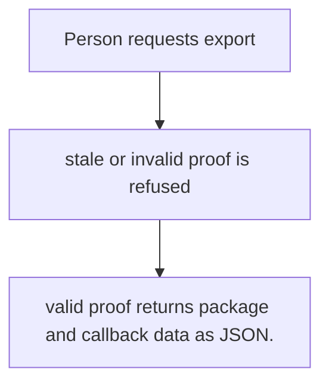
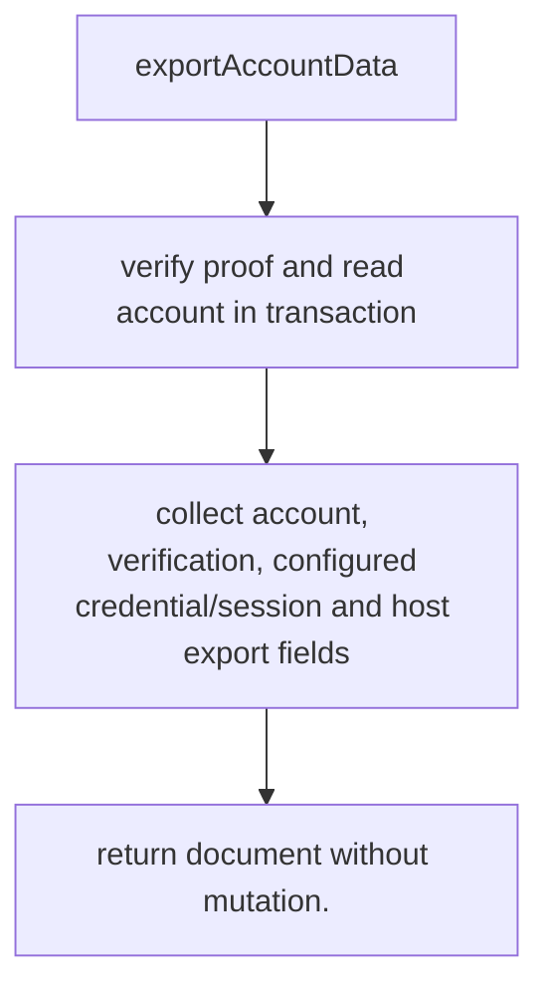

# US-ACCOUNT-18 — Export account data

As an account holder, I want to download a JSON export of account data so that I can receive package-held and host-supplied account information.

**Status:** Current when `dataExport` is enabled
**Access:** Recent password/sign-in proof required; host supplies application-owned export callback and data.
**Entry:** Host endpoint calls `accountData.export`; managed export route is optional.
**Documentation:** [account-data.md](../docs/guide/account-data.md)
**Source:** [`src/account_export.ts`](../src/account_export.ts)
**Coverage:** [`tests/account_export.spec.ts`](../tests/account_export.spec.ts)

## Acceptance criteria

- **Inputs and result:** current account, required recent proof and host callback context; returns JSON export. The host owns any screen, request parsing and presentation unless the entry explicitly names a managed route or command.
- valid proof returns package and callback data as JSON.
- Refusal, expiry, stale state or post-commit delivery behavior follows the linked service contract; a committed mutation is not described as rolled back because a follow-up failed.

## User flow

## Code flow

Scope: this is the Account Kit service/command path. Host UI, route policy and external systems remain host-owned unless named.

**Code references:** [implementation](../src/account_export.ts), [`tests/account_export.spec.ts`](../tests/account_export.spec.ts)
