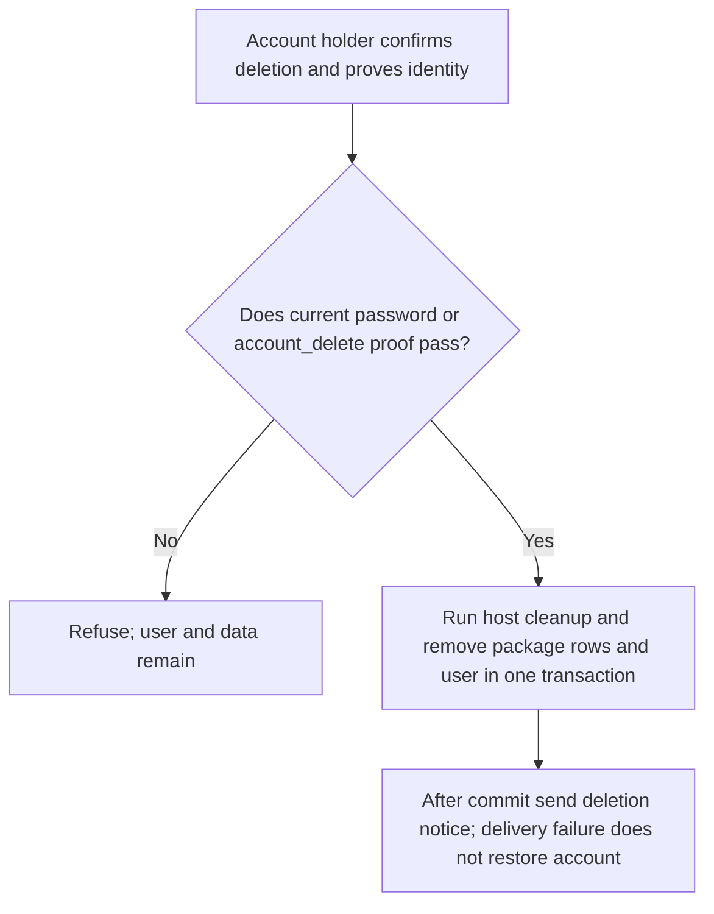
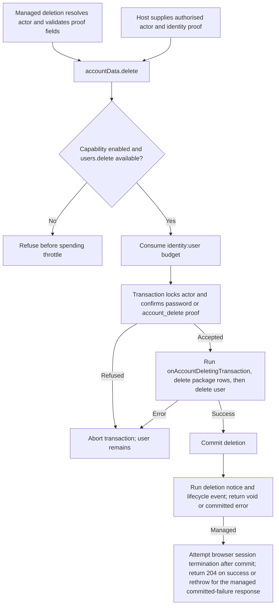

# US-ACCOUNT-19 — Delete an account

As an account holder, I want to close the account after proving identity so that I can remove package-owned records and invoke host cleanup atomically.

**Status:** Current when `accountDeletion` is enabled
**Access:** Current password required for password accounts, or purpose-bound `account_delete` recent proof for password-less accounts, which also requires `socialAuthentication` to be enabled (otherwise `E_ACCOUNT_KIT_NO_PASSWORD`); host defines and implements deletion callback for application-owned rows/retention.
**Entry:** Host calls `accountData.delete` or mounts `account.delete` (DELETE `account`, limited access).
**Documentation:** [account-data.md](../docs/guide/account-data.md)
**Source:** [`src/account_deletion.ts`](../src/account_deletion.ts)
**Coverage:** [`tests/account_deletion.spec.ts`](../tests/account_deletion.spec.ts)

## Acceptance criteria

- **Inputs and result:** `accountData.delete({ actorId, currentPassword?, recentProof? })` returns `void`. Password accounts prove the current password; password-less accounts use purpose-bound `account_delete` proof and need `socialAuthentication` enabled; without it they are refused with `E_ACCOUNT_KIT_NO_PASSWORD`, even when a proof is supplied. The configured transaction callback handles application-owned rows before package/user deletion.
- Managed deletion validates proof fields and returns 204 on success. The session handler attempts browser session termination after commit, including when a committed follow-up failure is surfaced.
- If the managed write recognises a committed follow-up failure, it returns 202 with `{ committed: true }`.

## User flow

## Code flow

**Code references:** [implementation](../src/account_deletion.ts), [`confirmActor`](../src/actor_confirmation.ts), [`tests/account_deletion.spec.ts`](../tests/account_deletion.spec.ts), [managed account data](../src/http/handlers_account_data.ts), [session termination](../src/http/session_end.ts), [package-owned rows](../src/user_rows.ts), [managed committed-failure response](../src/http/managed.ts)
