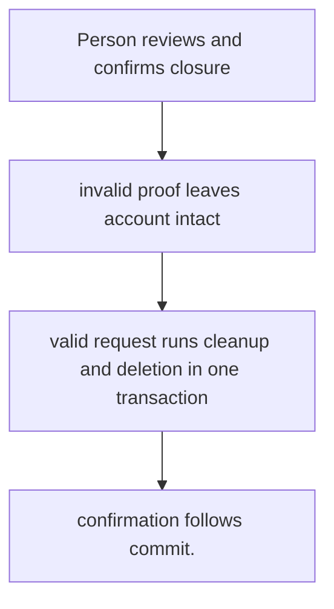
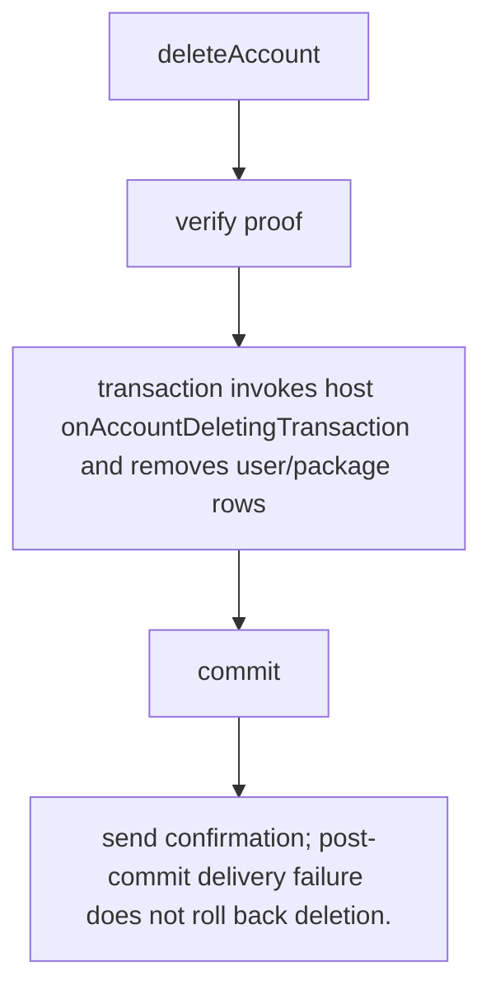

# US-ACCOUNT-19 — Delete an account

As an account holder, I want to close the account after proving identity so that I can remove package-owned records and invoke host cleanup atomically.

**Status:** Current when `accountDeletion` is enabled
**Access:** Recent proof required; host defines and implements deletion callback for application-owned rows/retention.
**Entry:** Host-owned endpoint calls `accountData.delete`; managed deletion route is optional.
**Documentation:** [account-data.md](../docs/guide/account-data.md)
**Source:** [`src/account_deletion.ts`](../src/account_deletion.ts)
**Coverage:** [`tests/account_deletion.spec.ts`](../tests/account_deletion.spec.ts)

## Acceptance criteria

- **Inputs and result:** current account and recent proof; configured host deletion transaction hook. The host owns any screen, request parsing and presentation unless the entry explicitly names a managed route or command.
- confirmation follows commit.
- Refusal, expiry, stale state or post-commit delivery behavior follows the linked service contract; a committed mutation is not described as rolled back because a follow-up failed.

## User flow

## Code flow

Scope: this is the Account Kit service/command path. Host UI, route policy and external systems remain host-owned unless named.

**Code references:** [implementation](../src/account_deletion.ts), [`tests/account_deletion.spec.ts`](../tests/account_deletion.spec.ts)
