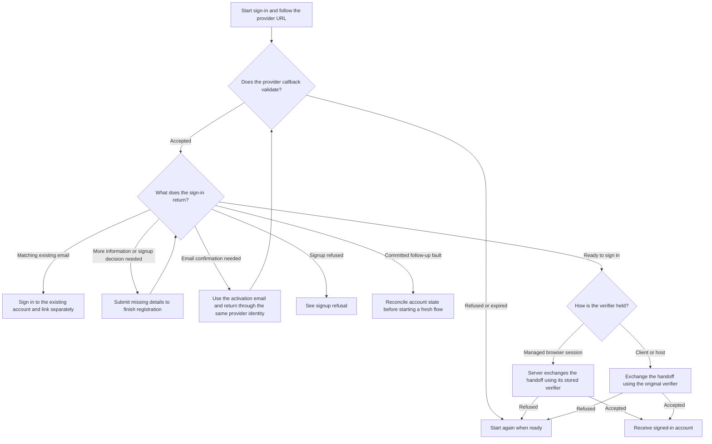
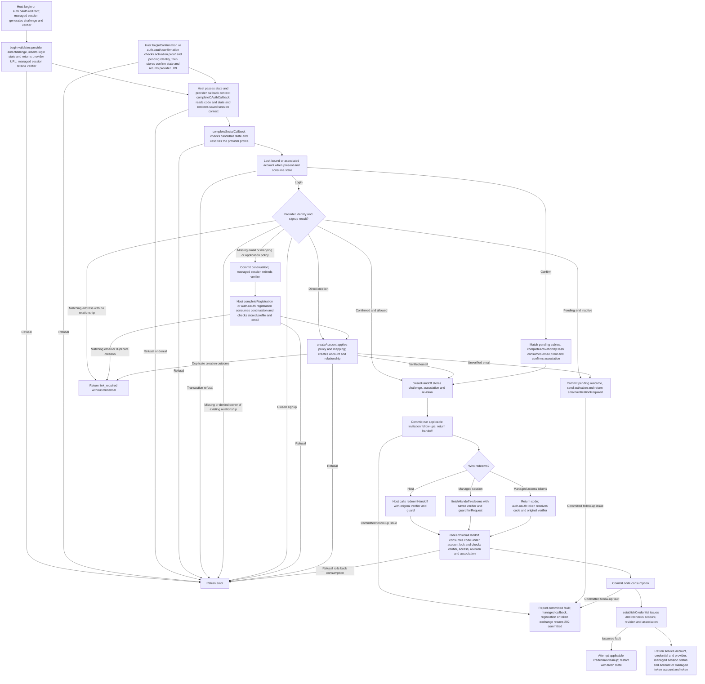

# US-ACCOUNT-20 — Sign in with a social provider

As a person with a configured provider identity, I want to sign in through Google or GitHub so that I can use an account under the host signup policy.

**Status:** Current when `socialAuthentication` is enabled with a configured provider
**Access:** Provider state binds the callback and the initiating client's verifier binds credential redemption. Confirmed relationships may sign in under closed registration if the account passes `canAccess`. New accounts follow the shared registration policy.
**Entry:** Host calls `socialAuthentication.begin({ provider, intent: 'login', clientChallenge, context? })`, or a managed client posts to `auth.oauth.redirect`.
**Documentation:** [Social authentication](../docs/guide/social-authentication.md) and [managed social routes](../docs/guide/managed-social.md#endpoints)
**Source:** [Service entry points](../src/social_identity.ts), [managed provider handlers](../src/http/social.ts)
**Coverage:** [Handoff](../tests/social_identity_handoff.spec.ts), [continuation](../tests/social_identity_continuation.spec.ts), [managed social](../tests/managed_social_http.spec.ts)

## Acceptance criteria

- `begin` accepts `google` or `github` when configured, `intent: 'login'`, a 43-character base64url SHA-256 `clientChallenge` and optional adapter `context`. It returns `{ state, url }`. The host sends the callback as `{ state, callback, provider?, intent?, admit? }`. Managed begin defaults to login and returns `{ authorizationUrl }`. The session strategy generates and retains its verifier, and the access-token client supplies a challenge and retains its verifier. Session POST routes require Shield CSRF.
- A confirmed linked subject yields `linked` and a handoff. A matching address without that relationship yields `link_required`. Missing email, configured field mapping or application signup policy yields a `new` continuation when signup is available. Submit `completeRegistration({ continuation, email?, registrationData?, admit? })` through trusted host code or managed `auth.oauth.registration`. The stored provider email takes precedence. Application signup requires the trusted `admit({ provider, subject, email }, trx)` callback. An existing email found during continuation can consume the continuation without creating an account.
- An unverified provider email creates an inactive account with a pending identity. A repeat login for that pending identity can resend activation. Start confirmation with `beginConfirmation({ provider, verificationToken, clientChallenge, context? })` or managed `auth.oauth.confirmation`. The fresh callback must match the same pending subject. Managed access-token confirmation forwards `intent: 'confirm'` along with the provider code and state to `auth.oauth.complete`.
- `redeemHandoff({ code, verifier, guard })` accepts a two-minute one-use code and a 43–128 character unreserved PKCE verifier. The transaction checks the challenge, access decision, current revision and original confirmed association. After it commits, the service issues and rechecks the selected credential and returns `{ account, credential, provider }`. An issuance failure after consumption requires a fresh flow.
- Managed session completion redeems with the stored verifier and returns `{ status, account }`. Managed access-token completion returns `{ status, code }`; post `{ code, verifier }` to `auth.oauth.token` for `{ account, token }`. A committed callback, registration or token exchange follow-up failure can return 202 `{ committed: true }`; reconcile before restarting with fresh state.

## User flow

## Code flow

Scope: host service and managed strategy entry points through sign-in. See [US-ACCOUNT-21](US-ACCOUNT-21-link-social-identity.md) for the separate linking journey.

**Code references:** [begin and confirmation](../src/social_identity.ts), [callback](../src/social_callback.ts), [registration continuation](../src/social_registration.ts), [account creation](../src/social_account_creation.ts), [handoff](../src/social_handoff.ts), [credential issuance](../src/credential_issuance.ts), [managed handlers](../src/http/social.ts), [session state](../src/http/social_session_state.ts), [activation](../src/activation_claim.ts), [managed error and committed response](../src/http/managed.ts)
