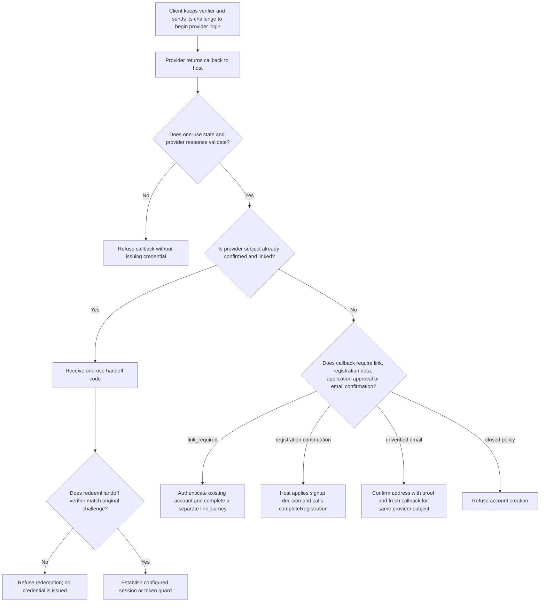
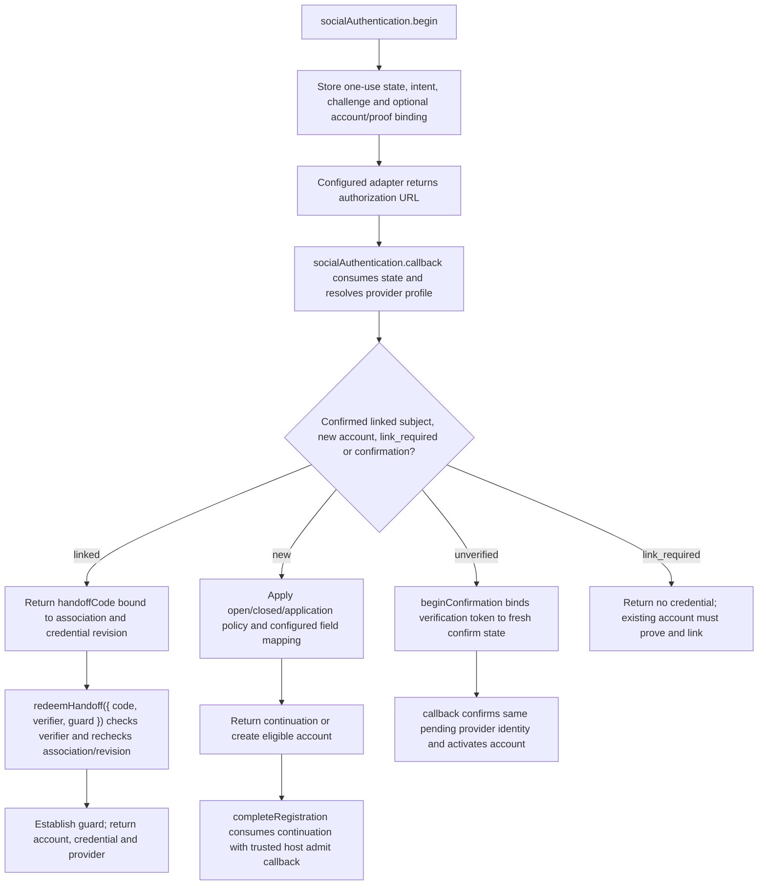

# US-ACCOUNT-20 — Sign in with a social provider

As a person with a configured provider identity, I want to sign in through Google or GitHub so that I can use an account under the host signup policy.

**Status:** Current for configured Ally provider and enabled `socialAuthentication`
**Access:** State and client challenge bind the callback. Existing linked identities must be confirmed; new-account eligibility follows the shared registration policy. Host owns provider credentials and callback routes.
**Entry:** Host calls `socialAuthentication.begin({ provider, intent: 'login', clientChallenge, context? })`, handles callback with `state`, then redeems a linked handoff with `redeemHandoff({ code, verifier, guard })`.
**Documentation:** [Social authentication](../docs/guide/social-authentication.md) and [managed social routes](../docs/guide/managed-social.md)
**Source:** [`src/social_identity.ts`](../src/social_identity.ts)
**Coverage:** [`tests/social_identity_handoff.spec.ts`](../tests/social_identity_handoff.spec.ts), [`tests/social_identity_continuation.spec.ts`](../tests/social_identity_continuation.spec.ts), [`tests/managed_social_http.spec.ts`](../tests/managed_social_http.spec.ts)

## Acceptance criteria

- `begin` takes provider (`google` or `github`), intent `login`, a 43-character base64url SHA-256 `clientChallenge`, and optional adapter context; it returns `{ state, url }`. `beginConfirmation` takes provider, activation `verificationToken`, the same challenge shape and optional context, returning `{ state, url }`. Callback takes `{ state, callback, provider?, admit? }` and returns `linked`/`new` with userId and optional handoffCode, `new` with continuation, `new` with `emailVerificationRequired`, `link_required`, or `reauthenticated` with proof. It does not issue an Adonis credential in the provider redirect.
- A confirmed `linked` result carries userId and a short-lived handoffCode; `redeemHandoff({ code, verifier, guard })` checks the verifier against the challenge and returns account, actual guard credential and provider. A matching email without a relationship returns `link_required`, not sign-in.
- A `new` continuation is completed by trusted host code with `completeRegistration({ continuation, email?, registrationData?, admit? })`; closed signup refuses and application policy remains host-owned. An unverified provider email cannot sign in; confirmation uses `beginConfirmation({ provider, verificationToken, clientChallenge, context? })` followed by `callback({ state, callback })`, matching the email proof to the same pending subject.

## User flow

## Code flow

Scope: provider adapter supplies provider URL/profile; Account Kit owns state, local identity resolution and handoff. Host owns Ally credentials, routes and application signup decision.

**Code references:** [`social identity methods`](../src/social_identity.ts), [`provider callback flow`](../src/http/social.ts), [`handoff tests`](../tests/social_identity_handoff.spec.ts), [`continuation tests`](../tests/social_identity_continuation.spec.ts)
