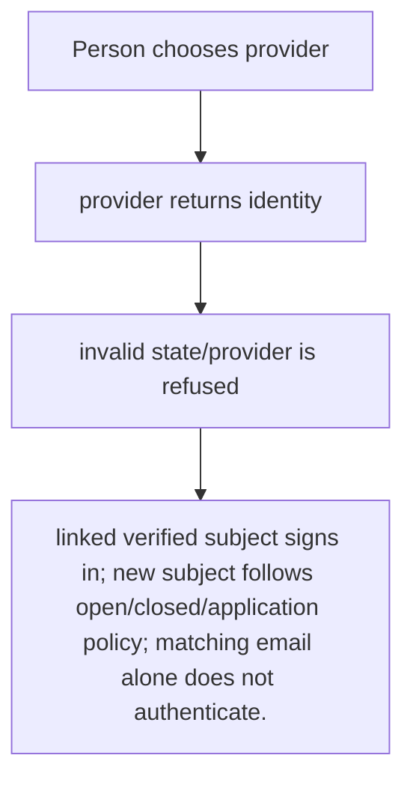
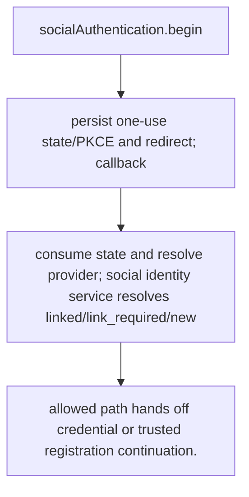

# US-ACCOUNT-20 — Sign in with a social provider

As a person with a configured provider identity, I want to authenticate through an enabled Google or GitHub integration so that I can use a verified provider identity under the application signup policy.

**Status:** Current for configured provider and enabled social authentication
**Access:** Provider state and PKCE binding are checked; new-account outcome follows registration config; host owns Ally credentials and callback URLs.
**Entry:** Host starts `socialAuthentication.begin({ provider, intent: 'login', clientChallenge })` and handles callback; routes are optional.
**Documentation:** [social-authentication.md](../docs/guide/social-authentication.md)
**Source:** [`src/social_identity.ts`](../src/social_identity.ts)
**Coverage:** [`tests/managed_social_http.spec.ts`](../tests/managed_social_http.spec.ts), [`tests/social_identity_handoff.spec.ts`](../tests/social_identity_handoff.spec.ts)

## Acceptance criteria

- **Inputs and result:** provider, intent, client challenge, callback state and provider response; application mode may require completion continuation. The host owns any screen, request parsing and presentation unless the entry explicitly names a managed route or command.
- linked verified subject signs in; new subject follows open/closed/application policy; matching email alone does not authenticate.
- Refusal, expiry, stale state or post-commit delivery behavior follows the linked service contract; a committed mutation is not described as rolled back because a follow-up failed.

## User flow

## Code flow

Scope: this is the Account Kit service/command path. Host UI, route policy and external systems remain host-owned unless named.

**Code references:** [implementation](../src/social_identity.ts), [`tests/managed_social_http.spec.ts`](../tests/managed_social_http.spec.ts), [`tests/social_identity_handoff.spec.ts`](../tests/social_identity_handoff.spec.ts)
