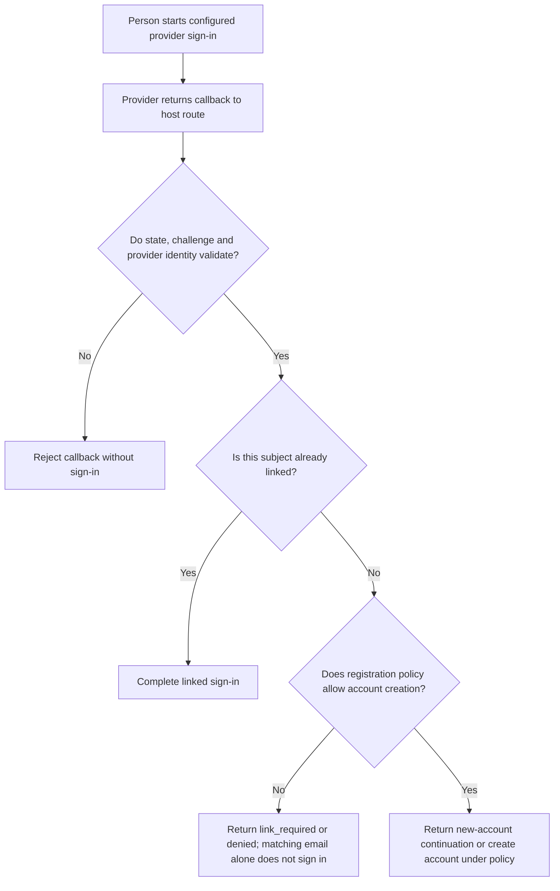
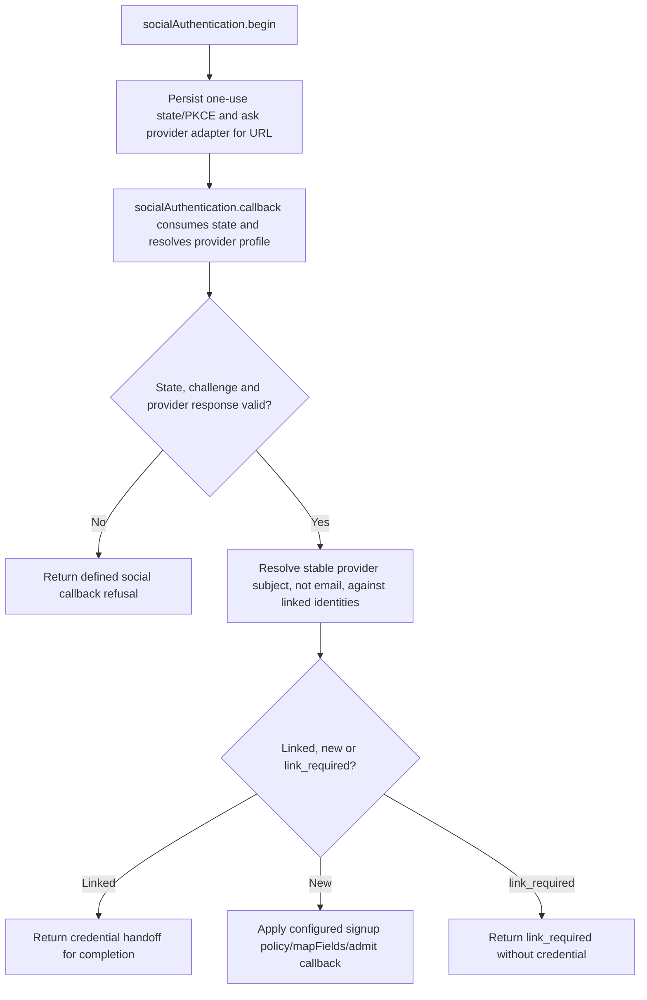

# US-ACCOUNT-20 — Sign in with a social provider

As a person with a configured provider identity, I want to authenticate through an enabled Google or GitHub integration so that I can use a verified provider identity under the application signup policy.

**Status:** Current for configured provider and enabled social authentication
**Access:** Provider state and PKCE binding are checked; new-account outcome follows registration config; host owns Ally credentials and callback URLs.
**Entry:** Host starts `socialAuthentication.begin({ provider, intent: 'login', clientChallenge })` and handles callback; routes are optional.
**Documentation:** [social-authentication.md](../docs/guide/social-authentication.md)
**Source:** [`src/social_identity.ts`](../src/social_identity.ts)
**Coverage:** [`tests/managed_social_http.spec.ts`](../tests/managed_social_http.spec.ts), [`tests/social_identity_handoff.spec.ts`](../tests/social_identity_handoff.spec.ts)

## Acceptance criteria

- **Inputs and result:** `socialAuthentication.begin({ provider, intent: 'login', clientChallenge, context? })` returns state and authorization URL. `callback({ state, callback, provider?, admit? })` returns a `linked`, `link_required`, `new`, or `reauthenticated` outcome; `linked` returns a userId and optional handoffCode; `new` may include a continuation or email-verification-required state; `link_required` returns no credential. Provider adapters support configured Google/GitHub only.

## User flow

## Code flow

Scope: this is the Account Kit service/command path. Host UI, route policy and external systems remain host-owned unless named.

**Code references:** [implementation](../src/social_identity.ts), [`tests/managed_social_http.spec.ts`](../tests/managed_social_http.spec.ts), [`tests/social_identity_handoff.spec.ts`](../tests/social_identity_handoff.spec.ts)
