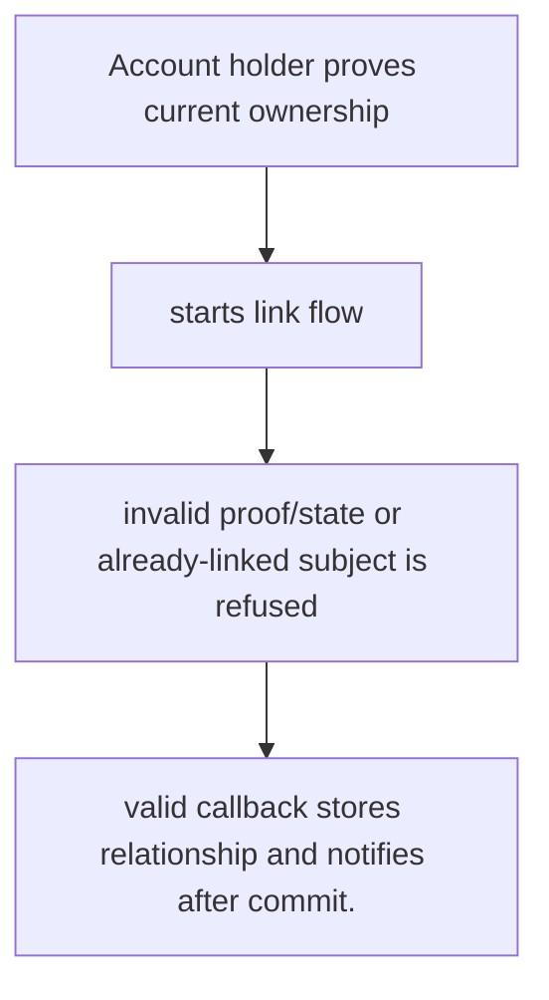
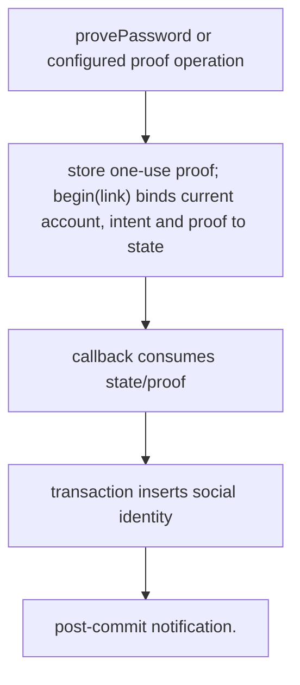

# US-ACCOUNT-21 — Link a social identity

As a signed-in account holder, I want to link a provider identity after recent proof so that I can add an alternative sign-in for this account.

**Status:** Current when social authentication is configured
**Access:** Authenticated current account plus one-use recent `social_link` proof; provider state is bound to account and intent.
**Entry:** Host calls `provePassword` when applicable and begins a provider flow with intent `link`; callback is handled by host/managed route.
**Documentation:** [social-authentication.md](../docs/guide/social-authentication.md)
**Source:** [`src/social_identity.ts`](../src/social_identity.ts)
**Coverage:** [`tests/social_identity_link.spec.ts`](../tests/social_identity_link.spec.ts)

## Acceptance criteria

- **Inputs and result:** current account, provider, client challenge, recent proof and provider callback. The host owns any screen, request parsing and presentation unless the entry explicitly names a managed route or command.
- valid callback stores relationship and notifies after commit.
- Refusal, expiry, stale state or post-commit delivery behavior follows the linked service contract; a committed mutation is not described as rolled back because a follow-up failed.

## User flow

## Code flow

Scope: this is the Account Kit service/command path. Host UI, route policy and external systems remain host-owned unless named.

**Code references:** [implementation](../src/social_identity.ts), [`tests/social_identity_link.spec.ts`](../tests/social_identity_link.spec.ts)
