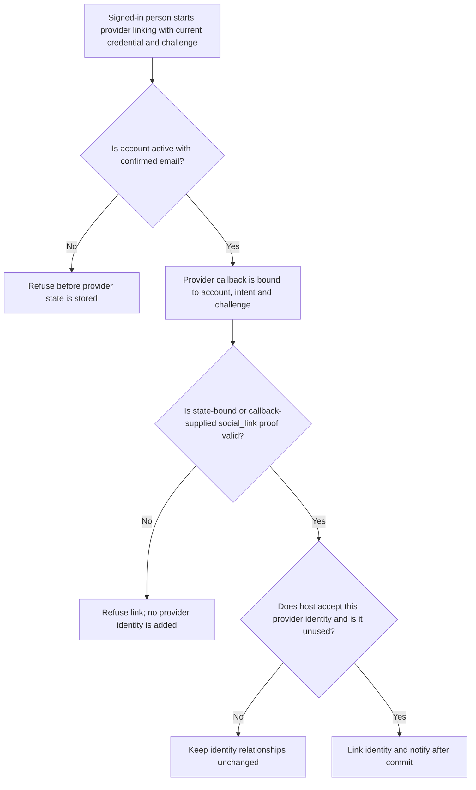
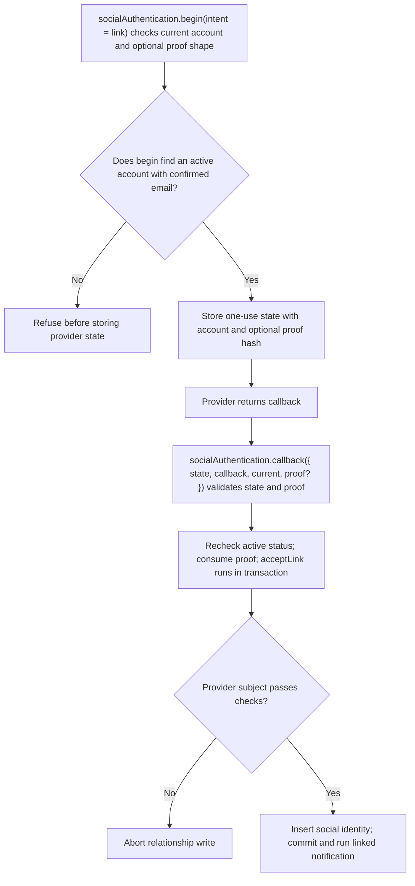

# US-ACCOUNT-21 — Link a social identity

As a signed-in account holder, I want to link a provider identity after recent proof so that I can add an alternative sign-in for this account.

**Status:** Current when social authentication is configured
**Access:** Authenticated current, active account with confirmed email plus one-use recent `social_link` proof; provider state is bound to account and intent.
**Entry:** Host begins a provider flow with intent `link`; callback is handled by host/managed route, which may provide `social_link` proof at callback time.
**Documentation:** [social-authentication.md](../docs/guide/social-authentication.md)
**Source:** [`src/social_identity.ts`](../src/social_identity.ts), [`src/social_callback.ts`](../src/social_callback.ts)
**Coverage:** [`tests/social_identity_link.spec.ts`](../tests/social_identity_link.spec.ts)

## Acceptance criteria

- **Inputs and result:** `socialAuthentication.begin({ provider, intent: 'link', current, clientChallenge, proof? })` returns state and URL for the current active account with confirmed email; optional proof is shape-checked and bound to that state. At callback, pass `{ state, callback, current, proof? }`: a state-bound proof may be omitted there, while proof may instead be supplied at callback and checked then. Password accounts obtain one-use `social_link` proof with `provePassword({ current, password, purpose: social_link })`.

## User flow

## Code flow

Scope: this is the Account Kit service/command path. Host UI, route policy and external systems remain host-owned unless named.

**Code references:** [begin and callback API](../src/social_identity.ts), [callback proof handling](../src/social_callback.ts), [`tests/social_identity_link.spec.ts`](../tests/social_identity_link.spec.ts)
