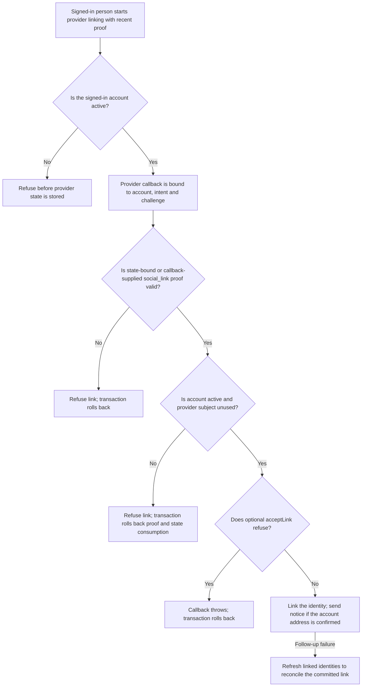
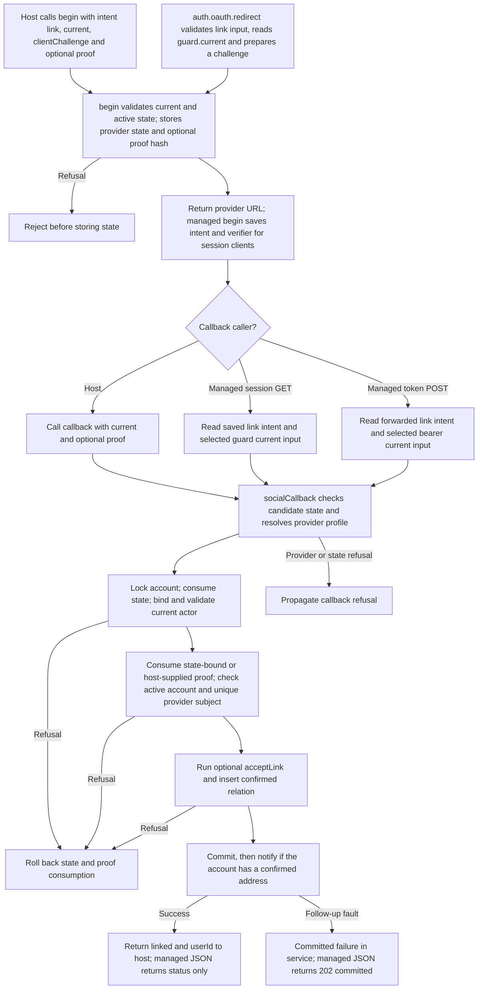

# US-ACCOUNT-21 — Link a social identity

As a signed-in account holder, I want to link a provider identity after recent proof so that I can add an alternative sign-in for this account.

**Status:** Current when `socialAuthentication` is enabled
**Access:** An authenticated current and active account plus one-use recent `social_link` proof; provider state is bound to account and intent.
**Entry:** Host calls `socialAuthentication.begin` with intent `link` or posts to managed `auth.oauth.redirect`. Managed session clients use the GET callback. Access-token clients forward the provider response to `auth.oauth.complete` with intent `link` and the current bearer.
**Documentation:** [Social authentication](../docs/guide/social-authentication.md#linking-and-sensitive-actions-require-recent-proof) and [managed endpoints](../docs/guide/managed-social.md#endpoints)
**Source:** [`src/social_identity.ts`](../src/social_identity.ts), [`src/social_callback.ts`](../src/social_callback.ts)
**Coverage:** [`tests/social_identity_link.spec.ts`](../tests/social_identity_link.spec.ts)

## Acceptance criteria

- **Service inputs:** `socialAuthentication.begin({ provider, intent: 'link', current, clientChallenge, proof? })` returns state and URL for the current active account; optional proof is shape-checked and bound to that state. At callback, pass `{ state, callback, current, proof? }`: a state-bound proof may be omitted there, while proof may instead be supplied at callback. A state-bound proof takes precedence. Obtain a one-use proof via [US-ACCOUNT-23](US-ACCOUNT-23-prove-social-action.md). Callback state/proof consumption, active-account and provider-uniqueness checks, optional `acceptLink`, and insertion share one transaction; refusal before commit rolls back consumption. The optional `acceptLink(user, profile)` receives the locked account and `{ provider, subject, email, emailVerified }` and may throw to refuse.
- **Managed inputs and results:** Supply proof at begin. The session strategy makes the challenge and saves the intent server-side. Access-token clients supply a challenge and forward `state`, provider `code` and `intent: 'link'` with the selected bearer. Managed callbacks return 200 `{ status: 'linked' }`; the service also returns `userId`. A failed follow-up to a committed link can give 202 `{ committed: true }` on managed routes. Refresh the linked list to reconcile.

## User flow

## Code flow

Scope: host and managed inputs through linking and delivery.

**Code references:** [begin and callback API](../src/social_identity.ts), [callback checks](../src/social_callback.ts), [managed provider handlers](../src/http/social.ts), [managed responses](../src/http/managed.ts), [link tests](../tests/social_identity_link.spec.ts)
