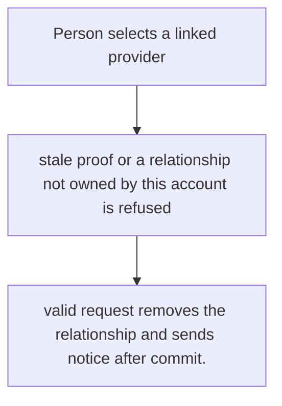
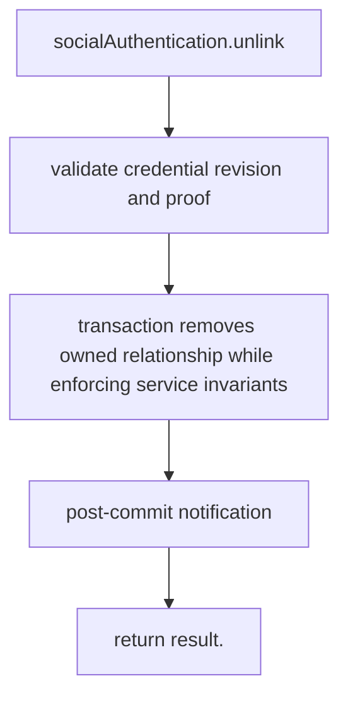

# US-ACCOUNT-22 — Unlink a social identity

As a signed-in account holder, I want to remove a linked provider identity so that I can stop that provider from authenticating this account.

**Status:** Current when social authentication is configured
**Access:** Authenticated current account and recent proof; application must ensure another usable credential remains per its policy.
**Entry:** Host calls `socialAuthentication.unlink({ current, provider, proof })`; no built-in identity settings screen.
**Documentation:** [social-authentication.md](../docs/guide/social-authentication.md)
**Source:** [`src/social_identity.ts`](../src/social_identity.ts)
**Coverage:** [`tests/social_identity_unlink.spec.ts`](../tests/social_identity_unlink.spec.ts)

## Acceptance criteria

- **Inputs and result:** current account, identityId and a one-use `social_unlink` proof; service preserves at least one way to sign in. The host owns any screen, request parsing and presentation unless the entry explicitly names a managed route or command.
- valid request removes the relationship and sends notice after commit.
- Refusal, expiry, stale state or post-commit delivery behavior follows the linked service contract; a committed mutation is not described as rolled back because a follow-up failed.

## User flow

## Code flow

Scope: this is the Account Kit service/command path. Host UI, route policy and external systems remain host-owned unless named.

**Code references:** [implementation](../src/social_identity.ts), [`tests/social_identity_unlink.spec.ts`](../tests/social_identity_unlink.spec.ts)
