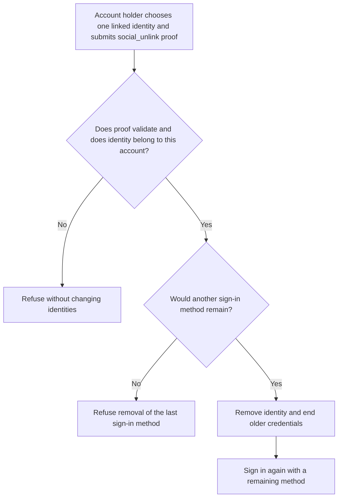
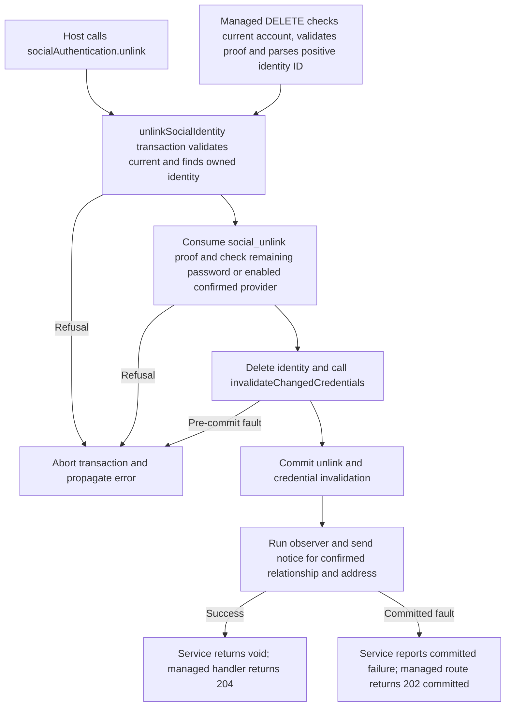

# US-ACCOUNT-22 — Unlink a social identity

As a signed-in account holder, I want to remove a linked provider identity so that I can stop that provider from authenticating this account.

**Status:** Current when `socialAuthentication` is enabled
**Access:** Authenticated current account and one-use `social_unlink` proof; the package refuses to remove the last usable sign-in method.
**Entry:** Host calls `socialAuthentication.unlink({ current, identityId, proof })`, or sends DELETE `account/social-identities/:id` to managed `account.socialIdentities.unlink`.
**Documentation:** [Social authentication](../docs/guide/social-authentication.md#linking-and-sensitive-actions-require-recent-proof) and [managed endpoints](../docs/guide/managed-social.md#endpoints)
**Source:** [`src/social_identity.ts`](../src/social_identity.ts)
**Coverage:** [`tests/social_identity_unlink.spec.ts`](../tests/social_identity_unlink.spec.ts)

## Acceptance criteria

- Choose an owned identity with numeric `identityId` and provide a one-use `social_unlink` proof. Managed DELETE requires a canonical positive safe-integer ID and non-empty `{ proof }` body, plus Shield CSRF for sessions.
- A password or another confirmed identity for an enabled provider must remain. If refused before commit, proof consumption rolls back. Success returns `void` or managed 204 and ends older credentials, including the credential used for the request. Sign in again with a remaining method.
- The credential observer runs after commit. Notification requires a confirmed relationship and confirmed account address. Follow-up failure preserves the unlink and can return managed 202 `{ committed: true }`.

## User flow

## Code flow

Scope: managed or host entry through unlink, invalidation and follow-ups.

**Code references:** [service entry](../src/social_identity.ts), [unlink transaction](../src/social_links.ts), [credential invalidation](../src/credential_revision.ts), [managed execution](../src/http/managed_execution.ts), [managed handlers](../src/http/managed_social_account_handlers.ts), [managed responses](../src/http/managed.ts), [unlink tests](../tests/social_identity_unlink.spec.ts)
