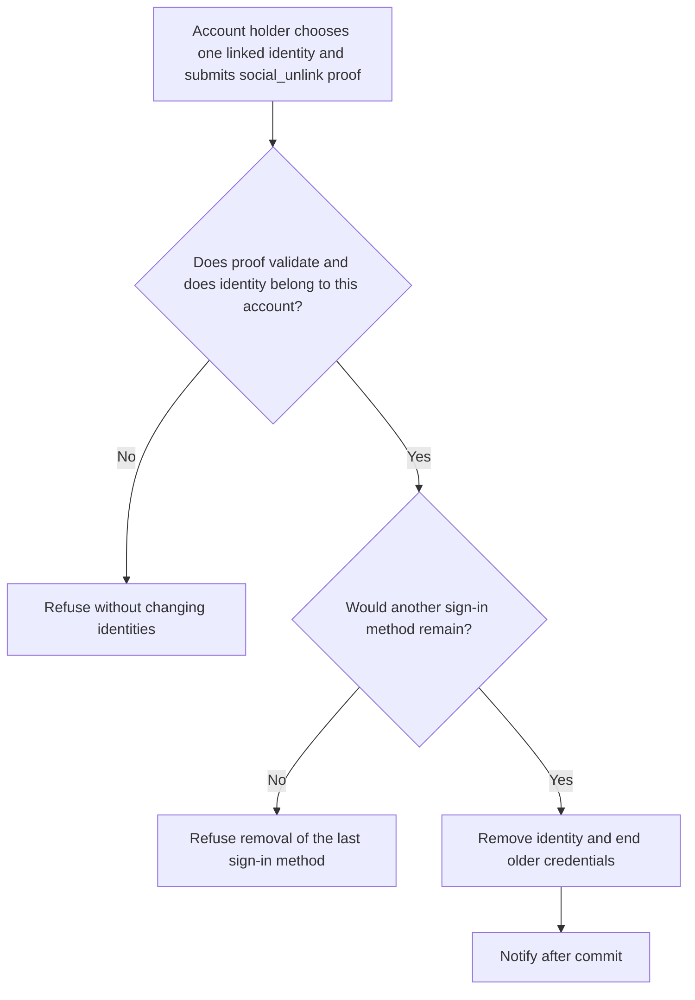
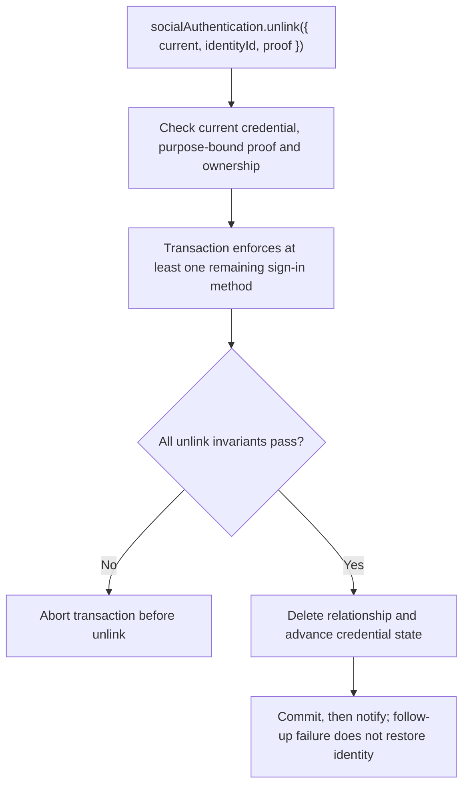

# US-ACCOUNT-22 — Unlink a social identity

As a signed-in account holder, I want to remove a linked provider identity so that I can stop that provider from authenticating this account.

**Status:** Current when social authentication is configured
**Access:** Authenticated current account and one-use `social_unlink` proof; the package refuses to remove the last usable sign-in method.
**Entry:** Host calls `socialAuthentication.unlink({ current, identityId, proof })`; no built-in identity settings screen.
**Documentation:** [social-authentication.md](../docs/guide/social-authentication.md)
**Source:** [`src/social_identity.ts`](../src/social_identity.ts)
**Coverage:** [`tests/social_identity_unlink.spec.ts`](../tests/social_identity_unlink.spec.ts)

## Acceptance criteria

- **Inputs and result:** `socialAuthentication.unlink({ current, identityId, proof })` returns `void`. `proof` must be a one-use `social_unlink` proof. The package prevents removing the account’s last sign-in method and invalidates older credentials on a successful unlink.

## User flow

## Code flow

Scope: this is the Account Kit service/command path. Host UI, route policy and external systems remain host-owned unless named.

**Code references:** [implementation](../src/social_identity.ts), [`tests/social_identity_unlink.spec.ts`](../tests/social_identity_unlink.spec.ts)
