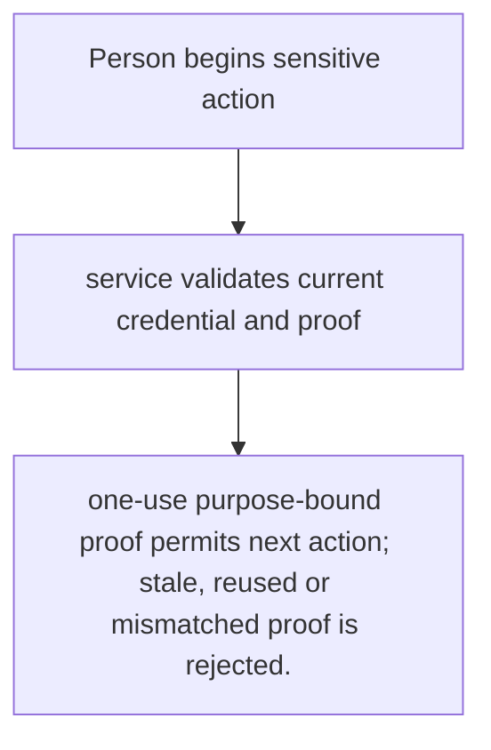
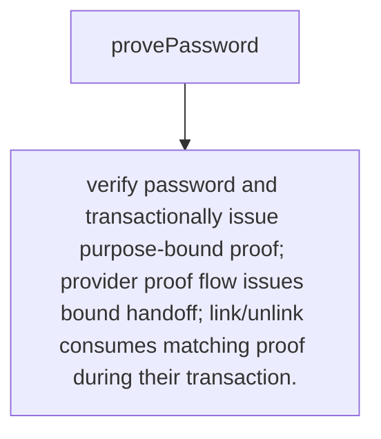

# US-ACCOUNT-23 — Prove a recent social action

As a signed-in account holder, I want to provide recent proof before a sensitive social identity change so that I can limit damage from a stolen active session.

**Status:** Current when social authentication is configured
**Access:** Service requires current credential; proof type and verification depend on configured password/provider flow.
**Entry:** Host invokes `socialAuthentication.provePassword` or provider recent-proof flow before link/unlink; host owns prompts and route policy.
**Documentation:** [social-authentication.md](../docs/guide/social-authentication.md)
**Source:** [`src/social_identity.ts`](../src/social_identity.ts)
**Coverage:** [`tests/social_identity_reauth.spec.ts`](../tests/social_identity_reauth.spec.ts)

## Acceptance criteria

- **Inputs and result:** current account, password or supported recent provider proof, purpose and client binding as required. The host owns any screen, request parsing and presentation unless the entry explicitly names a managed route or command.
- one-use purpose-bound proof permits next action; stale, reused or mismatched proof is rejected.
- Refusal, expiry, stale state or post-commit delivery behavior follows the linked service contract; a committed mutation is not described as rolled back because a follow-up failed.

## User flow

## Code flow

Scope: this is the Account Kit service/command path. Host UI, route policy and external systems remain host-owned unless named.

**Code references:** [implementation](../src/social_identity.ts), [`tests/social_identity_reauth.spec.ts`](../tests/social_identity_reauth.spec.ts)
