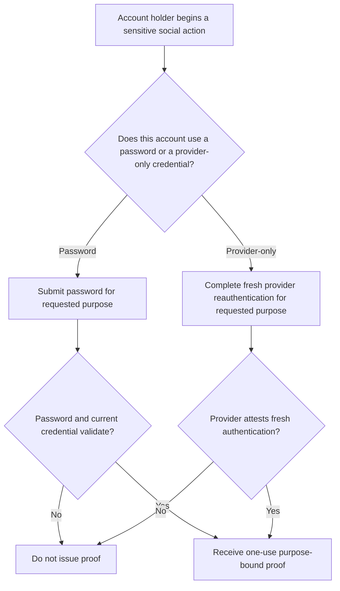
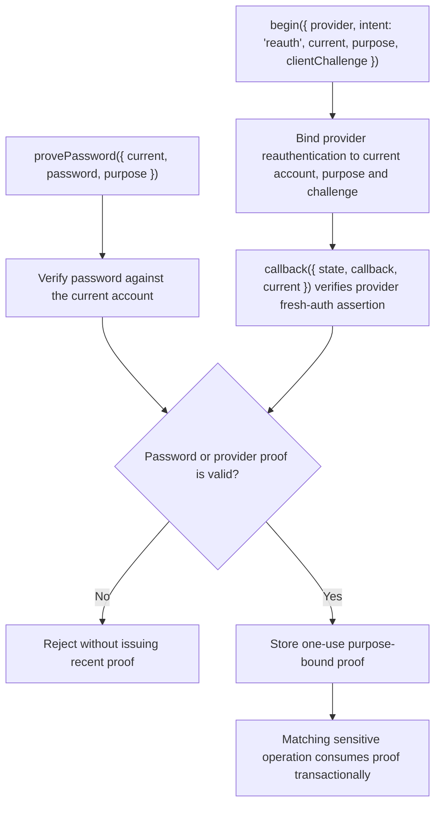

# US-ACCOUNT-23 — Prove a recent social action

As a signed-in account holder, I want to provide recent proof before a sensitive social identity change so that I can limit damage from a stolen active session.

**Status:** Current when social authentication is configured
**Access:** Service requires current credential; proof type and verification depend on configured password/provider flow.
**Entry:** Host invokes `socialAuthentication.provePassword` or provider recent-proof flow before link/unlink; host owns prompts and route policy.
**Documentation:** [social-authentication.md](../docs/guide/social-authentication.md)
**Source:** [`src/social_identity.ts`](../src/social_identity.ts)
**Coverage:** [`tests/social_identity_reauth.spec.ts`](../tests/social_identity_reauth.spec.ts)

## Acceptance criteria

- **Inputs and result:** `socialAuthentication.provePassword({ current, password, purpose })` returns a single-use proof for a supported sensitive purpose (`social_link`, `social_unlink`, `password_change`, `email_change`, `account_export` or `account_delete`). Provider reauthentication requires `begin({ provider, intent: 'reauth', current, purpose, clientChallenge })`, where `provider` selects the configured provider. Its callback also requires `current`; it returns proof only when that provider verifies fresh authentication for the bound current account.

## User flow

## Code flow

Scope: this is the Account Kit service/command path. Host UI, route policy and external systems remain host-owned unless named.

**Code references:** [implementation](../src/social_identity.ts), [`tests/social_identity_reauth.spec.ts`](../tests/social_identity_reauth.spec.ts)
