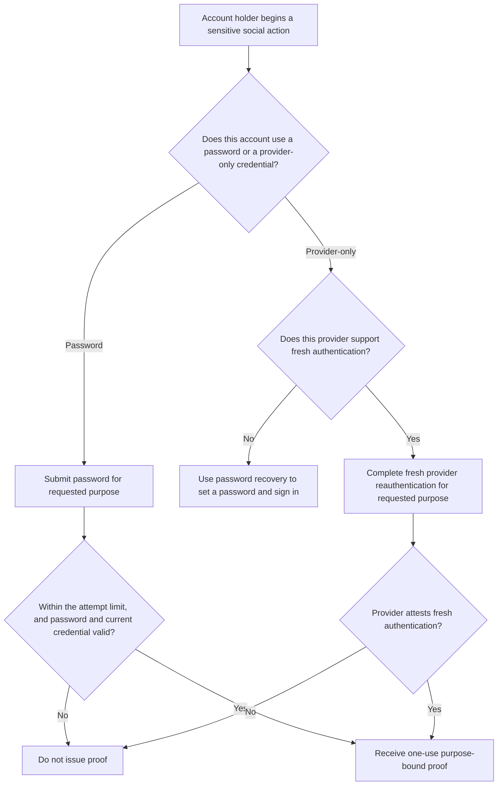
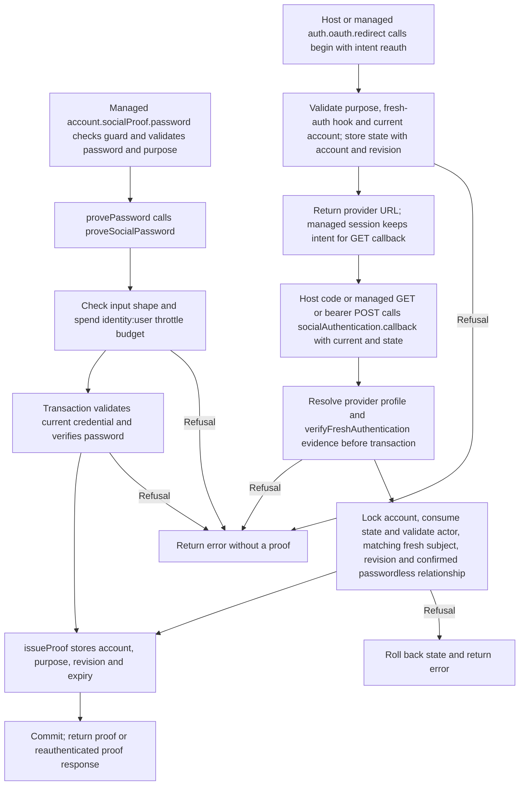

# US-ACCOUNT-23 — Prove a recent social action

As a signed-in account holder, I want to provide recent proof before a sensitive social identity change so that I can limit damage from a stolen active session.

**Status:** Current when `socialAuthentication` is enabled
**Access:** Service requires current credential; proof type and verification depend on configured password/provider flow.
**Entry:** Host invokes `socialAuthentication.provePassword` or provider reauthentication. Managed callers use `account.socialProof.password` or `auth.oauth.redirect` with intent `reauth` and complete its callback.
**Documentation:** [Provider-only recent proof](../docs/guide/social-authentication.md#provider-only-recent-proof) and [managed endpoints](../docs/guide/managed-social.md#endpoints)
**Source:** [`src/social_identity.ts`](../src/social_identity.ts)
**Coverage:** [`tests/social_identity_reauth.spec.ts`](../tests/social_identity_reauth.spec.ts)

## Acceptance criteria

- **Inputs and result:** `socialAuthentication.provePassword({ current, password, purpose })` returns a single-use proof for a supported sensitive purpose (`social_link`, `social_unlink`, `password_change`, `email_change`, `account_export` or `account_delete`). Provider reauthentication requires `begin({ provider, intent: 'reauth', current, purpose, clientChallenge })`, where `provider` selects the configured provider. Its callback also requires `current`; it returns `{ status: 'reauthenticated', proof }` when the provider attests fresh authentication for the same confirmed subject on a passwordless account. Each proof lasts ten minutes and is tied to the account, purpose and credential revision. Standard Ally adapters have no fresh-authentication hook. A passwordless account can [set its first password through recovery](US-ACCOUNT-01-recover-password.md).
- **Password proof limits:** `provePassword` refuses a missing `current`, a non-string password or an unsupported purpose with `SocialProofError` before anything else. It then spends the per-account `identity:user` throttle budget before the password is checked, so a caller who has used the budget gets `ThrottledError` instead of a password check. A wrong password, or an account without a password, also gives `SocialProofError`. Managed POST `account/social-proof/password` expects non-empty `password` and `purpose`, requires the selected guard and Shield CSRF for sessions, and returns 200 `{ proof }`.

## User flow

## Code flow

Scope: proof issuance. Matching sensitive operations implement their own consumption boundary, such as [US-ACCOUNT-21](US-ACCOUNT-21-link-social-identity.md) and [US-ACCOUNT-22](US-ACCOUNT-22-unlink-social-identity.md).

**Code references:** [service entries](../src/social_identity.ts), [proof issuance](../src/social_proofs.ts), [provider evidence checks](../src/social_callback.ts), [managed provider handlers](../src/http/social.ts), [managed password proof handler](../src/http/managed_social_account_handlers.ts), [proof tests](../tests/social_identity_reauth.spec.ts)
