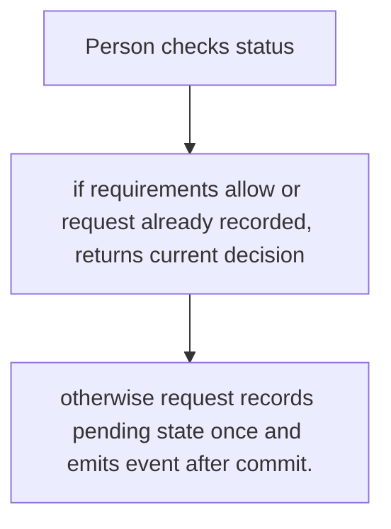
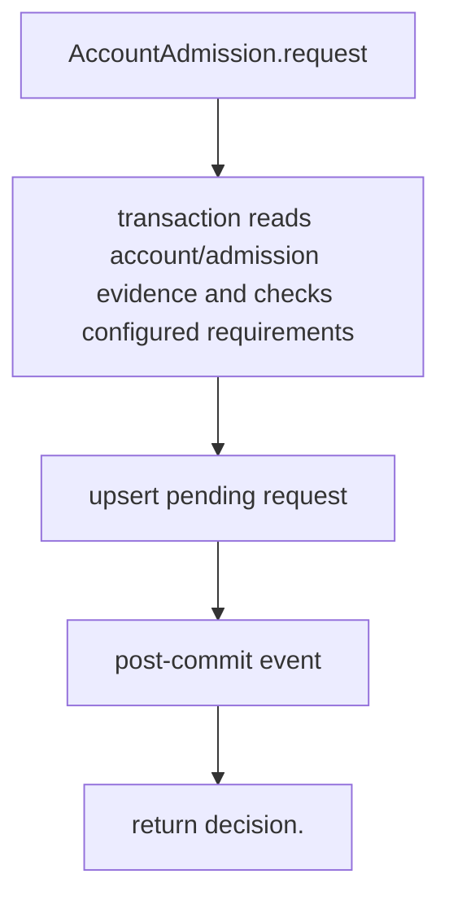

# US-ACCOUNT-24 — Request application admission

As a signed-in account holder, I want to request admission when configured requirements are unmet so that I can ask the application to review eligibility.

**Status:** Current when admission module is installed and approval requirement enabled
**Access:** Account must meet configured domain/invitation requirements; account must be confirmed; app owns reachable status/request route.
**Entry:** Host resolves `AccountAdmission` and calls `request({ userId })`; admission has no managed routes.
**Documentation:** [admission.md](../docs/guide/admission.md)
**Source:** [`src/admission/request.ts`](../src/admission/request.ts)
**Coverage:** [`tests/admission_request.spec.ts`](../tests/admission_request.spec.ts)

## Acceptance criteria

- **Inputs and result:** userId; returns admission record/outcome; repeated pending request is idempotent. The host owns any screen, request parsing and presentation unless the entry explicitly names a managed route or command.
- otherwise request records pending state once and emits event after commit.
- Refusal, expiry, stale state or post-commit delivery behavior follows the linked service contract; a committed mutation is not described as rolled back because a follow-up failed.

## User flow

## Code flow

Scope: this is the Account Kit service/command path. Host UI, route policy and external systems remain host-owned unless named.

**Code references:** [implementation](../src/admission/request.ts), [`tests/admission_request.spec.ts`](../tests/admission_request.spec.ts)
