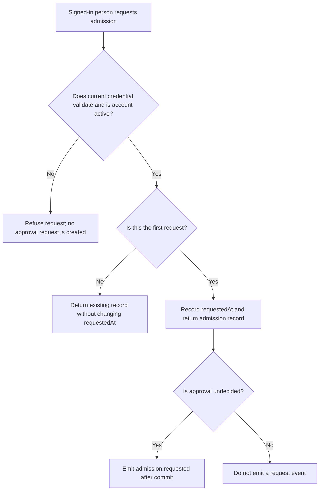
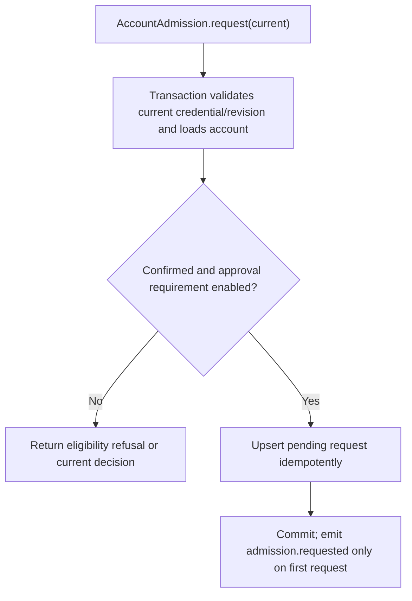

# US-ACCOUNT-24 — Request application admission

As a signed-in account holder, I want to request admission when configured requirements are unmet so that I can ask the application to review eligibility.

**Status:** Current when admission module is installed and approval requirement enabled
**Access:** A valid current credential and active (email-confirmed) account are required. This method does not evaluate domain or invitation eligibility; the host owns a reachable request route.
**Entry:** Host resolves `AccountAdmission` and calls `request(current)`; admission has no managed routes.
**Documentation:** [admission.md](../docs/guide/admission.md)
**Source:** [`src/admission/request.ts`](../src/admission/request.ts)
**Coverage:** [`tests/admission_request.spec.ts`](../tests/admission_request.spec.ts)

## Acceptance criteria

- **Inputs and result:** `AccountAdmission.request(current)` takes the full `CurrentAccountInput` (`userId` plus strategy-required revision and tokenId or sessionHandle) and returns the admission record. It validates the current credential and requires an active account; it does not evaluate domain or invitation eligibility. The first request records `requestedAt`, even if the account already has a decision. Repeats do not change that timestamp. `admission.requested` is emitted only for the first request with no decision yet.

## User flow

## Code flow

Scope: this is the Account Kit service/command path. Host UI, route policy and external systems remain host-owned unless named.

**Code references:** [implementation](../src/admission/request.ts), [`tests/admission_request.spec.ts`](../tests/admission_request.spec.ts)
