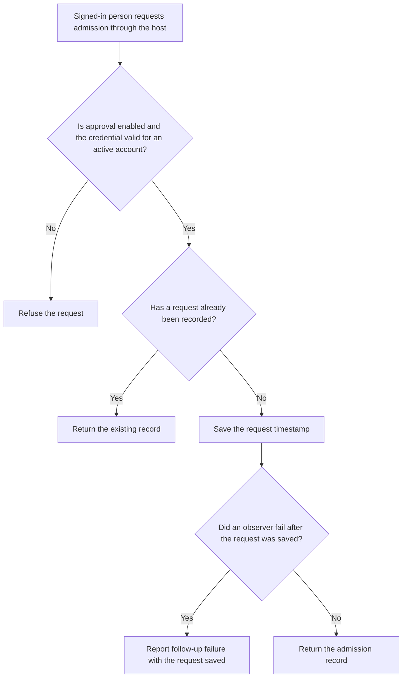
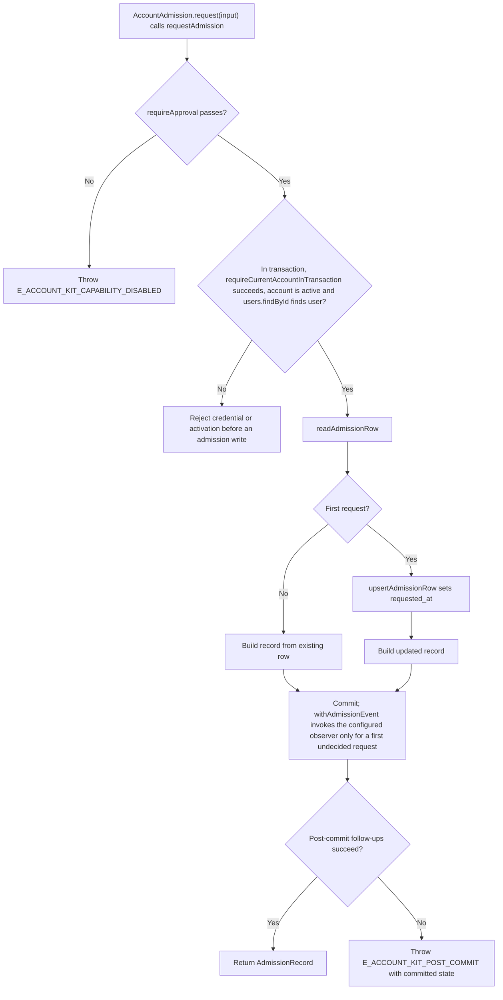

# US-ACCOUNT-24 — Request application admission

As a signed-in account holder, I want to request admission when configured requirements are unmet so that I can ask the application to review eligibility.

**Status:** Current when admission module is installed and approval requirement enabled
**Access:** A valid current credential and active (email-confirmed) account are required. This method does not evaluate domain or invitation eligibility; the host owns a reachable request route.
**Entry:** Host resolves `AccountAdmission` and calls `request(current)`; admission has no managed routes.
**Documentation:** [admission.md](../docs/guide/admission.md)
**Source:** [`src/admission/request.ts`](../src/admission/request.ts)
**Coverage:** [`tests/admission_request.spec.ts`](../tests/admission_request.spec.ts)

## Acceptance criteria

- `request(input)` takes the guard's `CurrentAccountInput` (see [credential evidence](US-ACCOUNT-56-read-current-admission-status.md)). Approval must be enabled and the account active. Domain and invitation requirements are outside this action.
- The first request sets `requestedAt`, including for an account with a decision. Repeated requests return the record with its original timestamp. Only the first undecided request generates `admission.requested`. If the configured observer fails, the caller gets `E_ACCOUNT_KIT_POST_COMMIT` and the timestamp is saved.

## User flow

## Code flow

Scope: this is the Account Kit service/command path. Host UI, route policy and external systems remain host-owned unless named.

The runnable API example traces the controller and middleware entry in its [admission code flow](../examples/api/README.md#admission-code-flow).

**Code references:** [implementation](../src/admission/request.ts), [`tests/admission_request.spec.ts`](../tests/admission_request.spec.ts), [service entry](../src/admission/service.ts), [credential check](../src/authentication.ts), [committed events](../src/admission/notifications.ts)
