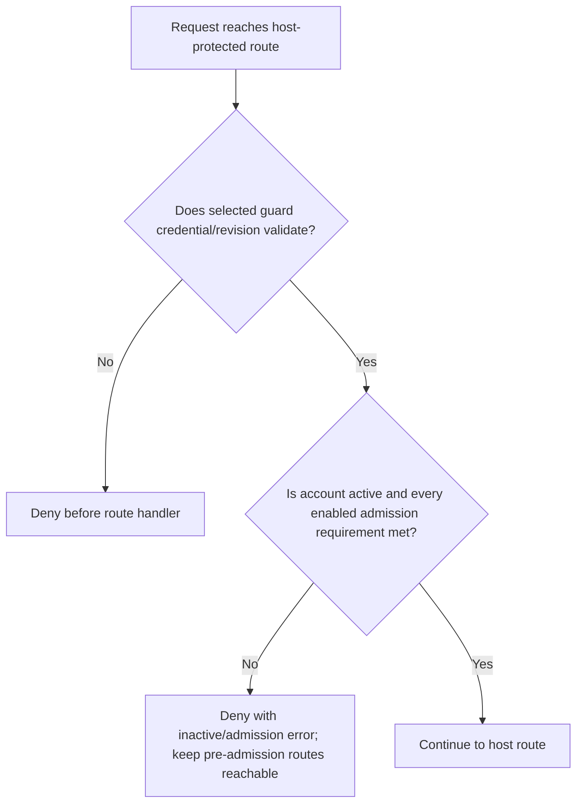
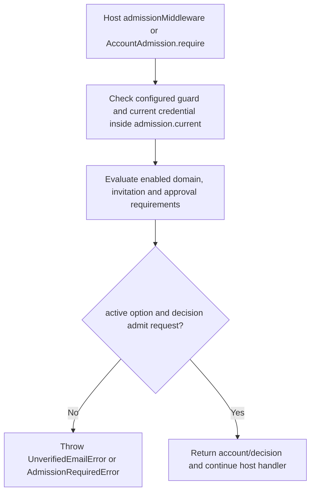

# US-ACCOUNT-25 — Gate a protected route by admission

As an application developer, I want to require admission before protected application data so that I can prevent non-admitted credentials from entering protected routes.

**Status:** Current when admission is installed and app applies middleware
**Access:** Host chooses guarded routes and keeps pre-admission status/sign-out routes reachable.
**Entry:** Host applies `admissionMiddleware` or calls `admission.require` in its own middleware/controller.
**Documentation:** [admission.md](../docs/guide/admission.md)
**Source:** [`src/admission/middleware.ts`](../src/admission/middleware.ts)
**Coverage:** [`tests/admission_gate.spec.ts`](../tests/admission_gate.spec.ts)

## Acceptance criteria

- **Inputs and result:** `AccountAdmission.require(current, { active? } = {})` returns account and decision or throws for invalid credential, inactive account when `active` is not false, or an unmet requirement. The host applies it only to routes that should require admission.

## User flow

## Code flow

Scope: this is the Account Kit service/command path. Host UI, route policy and external systems remain host-owned unless named.

**Code references:** [implementation](../src/admission/middleware.ts), [`tests/admission_gate.spec.ts`](../tests/admission_gate.spec.ts)
