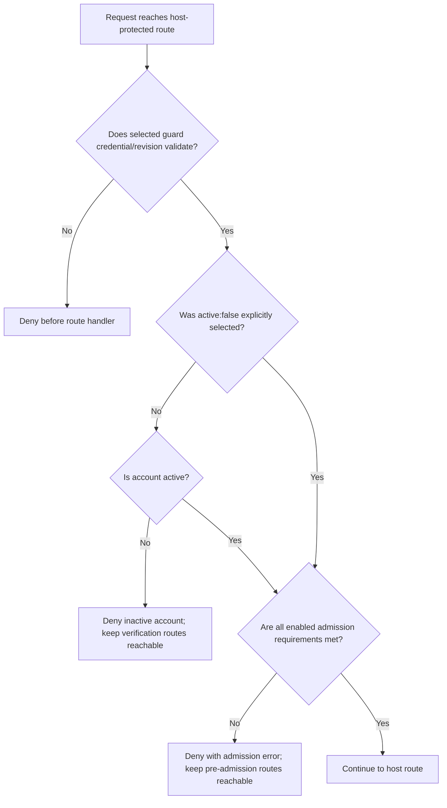
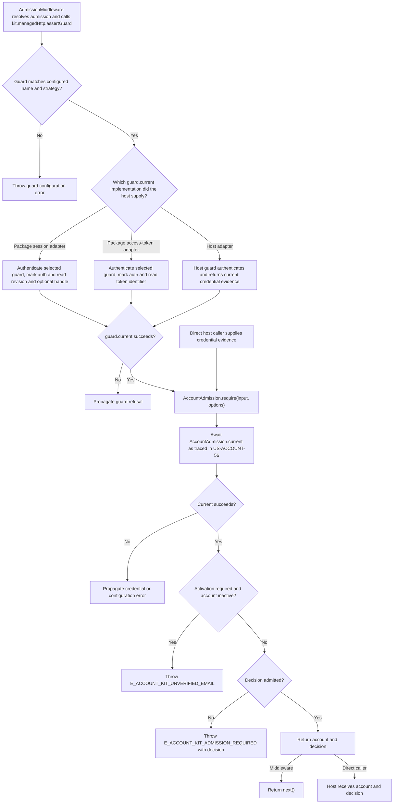

# US-ACCOUNT-25 — Gate a protected route by admission

As an application developer, I want to require admission before protected application data so that I can prevent non-admitted credentials from entering protected routes.

**Status:** Current when admission is installed and app applies middleware
**Access:** Host chooses guarded routes and keeps pre-admission status/sign-out routes reachable.
**Entry:** Host applies `AdmissionMiddleware` or calls `admission.require` in its own middleware/controller.
**Documentation:** [admission.md](../docs/guide/admission.md)
**Source:** [`src/admission/middleware.ts`](../src/admission/middleware.ts)
**Coverage:** [`tests/admission_gate.spec.ts`](../tests/admission_gate.spec.ts)

## Acceptance criteria

- `new AdmissionMiddleware({ admission, guard, active? })` resolves admission, checks the selected guard's name and strategy, and passes the credential evidence from `guard.current(context)` to `require`. The managed session and access-token adapters both authenticate and make the selected guard available to downstream application code.
- `AccountAdmission.require(input, { active? } = {})` evaluates current credentials and admission as in [US-ACCOUNT-56](US-ACCOUNT-56-read-current-admission-status.md). It then refuses an inactive account unless `active: false`, and refuses any unmet enabled requirement with `E_ACCOUNT_KIT_ADMISSION_REQUIRED` carrying the decision. A direct caller receives `{ account, decision }`; middleware continues to the host handler.

## User flow

## Code flow

Scope: this is the Account Kit service/command path. Host UI, route policy and external systems remain host-owned unless named.

The runnable API example traces the controller and middleware entry in its [admission code flow](../examples/api/README.md#admission-code-flow).

**Code references:** [implementation](../src/admission/middleware.ts), [`tests/admission_gate.spec.ts`](../tests/admission_gate.spec.ts), [require](../src/admission/service.ts), [current credential trace](US-ACCOUNT-56-read-current-admission-status.md#code-flow), [session guard adapter](../src/http/managed_session_guard.ts), [access-token guard adapter](../src/http/managed_token_guard.ts), [guard configuration check](../src/managed_http_service.ts)
