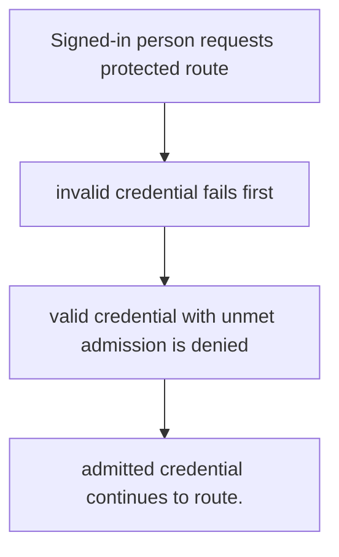
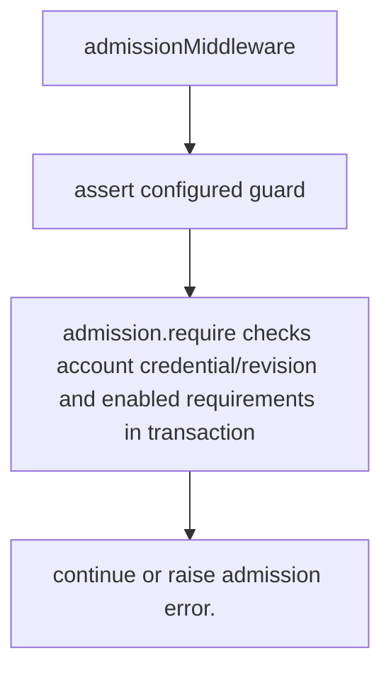

# US-ACCOUNT-25 — Gate a protected route by admission

As an application developer, I want to require admission before protected application data so that I can prevent non-admitted credentials from entering protected routes.

**Status:** Current when admission is installed and app applies middleware
**Access:** Host chooses guarded routes and keeps pre-admission status/sign-out routes reachable.
**Entry:** Host applies `admissionMiddleware` or calls `admission.require` in its own middleware/controller.
**Documentation:** [admission.md](../docs/guide/admission.md)
**Source:** [`src/admission/middleware.ts`](../src/admission/middleware.ts)
**Coverage:** [`tests/admission_gate.spec.ts`](../tests/admission_gate.spec.ts)

## Acceptance criteria

- **Inputs and result:** guard and active option configured by host; request credential is read from selected guard. The host owns any screen, request parsing and presentation unless the entry explicitly names a managed route or command.
- admitted credential continues to route.
- Refusal, expiry, stale state or post-commit delivery behavior follows the linked service contract; a committed mutation is not described as rolled back because a follow-up failed.

## User flow

## Code flow

Scope: this is the Account Kit service/command path. Host UI, route policy and external systems remain host-owned unless named.

**Code references:** [implementation](../src/admission/middleware.ts), [`tests/admission_gate.spec.ts`](../tests/admission_gate.spec.ts)
