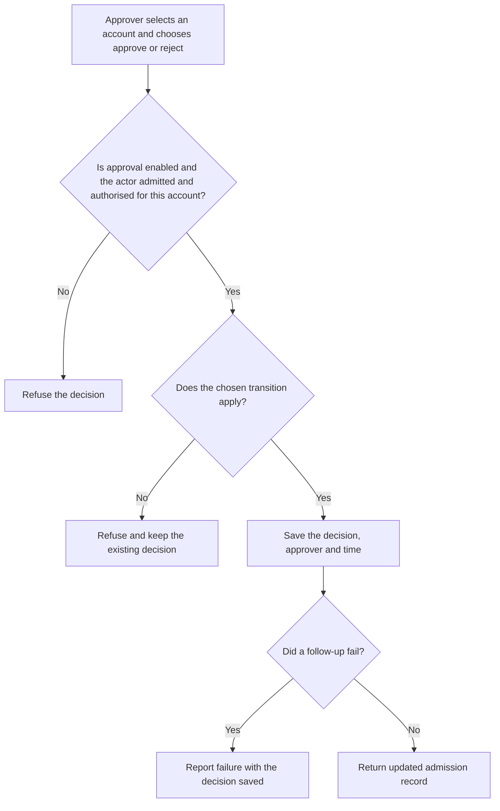
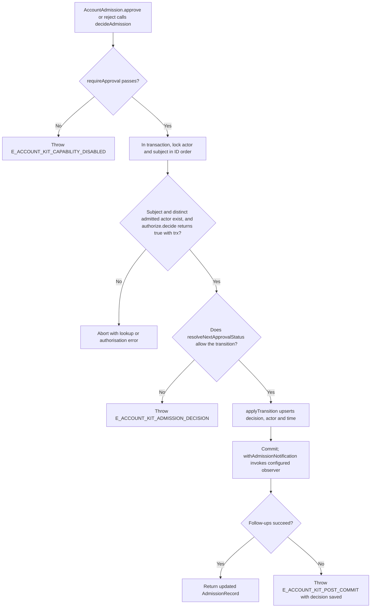

# US-ACCOUNT-26 — Review an admission request

As an authorised application approver, I want to approve or reject a pending person so that I can record an accountable admission decision.

**Status:** Current when approval is enabled
**Access:** Host `approval.authorize.decide` controls who may decide; Account Kit defines no application roles or admin UI.
**Entry:** Host-owned controller invokes `AccountAdmission.approve` or `.reject` with actor and target; operator commands are a separate shell path.
**Documentation:** [admission.md](../docs/guide/admission.md)
**Source:** [`src/admission/decisions.ts`](../src/admission/decisions.ts)
**Coverage:** [`tests/admission_decision.spec.ts`](../tests/admission_decision.spec.ts), [`tests/admission_decisions.spec.ts`](../tests/admission_decisions.spec.ts)

## Acceptance criteria

- `approve({ actorId, userId })` and `reject({ actorId, userId })` require approval to be enabled. The subject and actor must exist, the actor must differ from the subject and be admitted, and `approval.authorize.decide(actor, subject, { trx })` must return exactly `true`. The host supplies the actor from its authorised context.
- Approve from no decision, `rejected` or `revoked`; reject only from no decision. Neither action requires a prior request. A refused transition preserves the existing decision.
- Success returns the record with decision, actor and decision time. The configured observer receives `admission.approved` or `admission.rejected` after commit. If it fails, `E_ACCOUNT_KIT_POST_COMMIT` reports the already-saved decision.

## User flow

## Code flow

Scope: this is the Account Kit service/command path. Host UI, route policy and external systems remain host-owned unless named.

The runnable API example traces the controller and middleware entry in its [admission code flow](../examples/api/README.md#admission-code-flow).

**Code references:** [implementation](../src/admission/decisions.ts), [`tests/admission_decision.spec.ts`](../tests/admission_decision.spec.ts), [`tests/admission_decisions.spec.ts`](../tests/admission_decisions.spec.ts), [service entry](../src/admission/service.ts), [committed events](../src/admission/notifications.ts)
