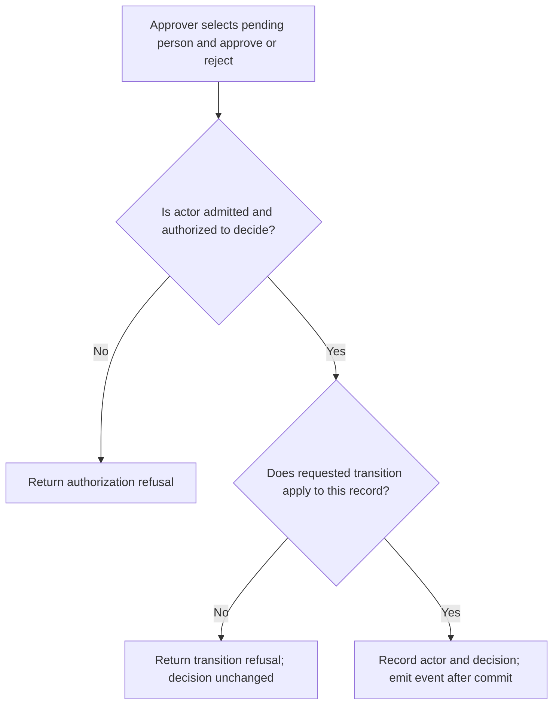
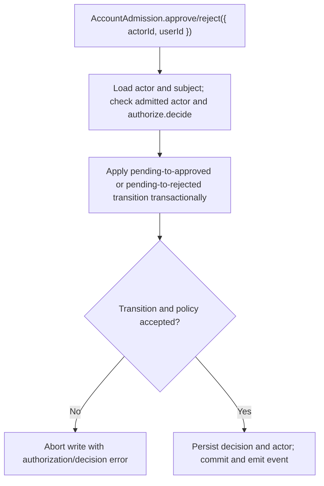

# US-ACCOUNT-26 — Review an admission request

As an authorized application approver, I want to approve or reject a pending person so that I can record an accountable admission decision.

**Status:** Current when approval is enabled
**Access:** Host `approval.authorize` decides who may list or decide; Account Kit defines no application roles or admin UI.
**Entry:** Host-owned controller invokes `AccountAdmission.approve` or `.reject` with actor and target; operator commands are a separate shell path.
**Documentation:** [admission.md](../docs/guide/admission.md)
**Source:** [`src/admission/decisions.ts`](../src/admission/decisions.ts)
**Coverage:** [`tests/admission_decision.spec.ts`](../tests/admission_decision.spec.ts), [`tests/admission_decisions.spec.ts`](../tests/admission_decisions.spec.ts)

## Acceptance criteria

- **Inputs and result:** `AccountAdmission.approve({ actorId, userId })` or `.reject({ actorId, userId })` returns the updated admission record. The actor must be admitted; `approval.authorize.decide(actor, subject, context)` determines permission. Approval requires an eligible pending transition; rejection applies only before a decision.

## User flow

## Code flow

Scope: this is the Account Kit service/command path. Host UI, route policy and external systems remain host-owned unless named.

**Code references:** [implementation](../src/admission/decisions.ts), [`tests/admission_decision.spec.ts`](../tests/admission_decision.spec.ts), [`tests/admission_decisions.spec.ts`](../tests/admission_decisions.spec.ts)
