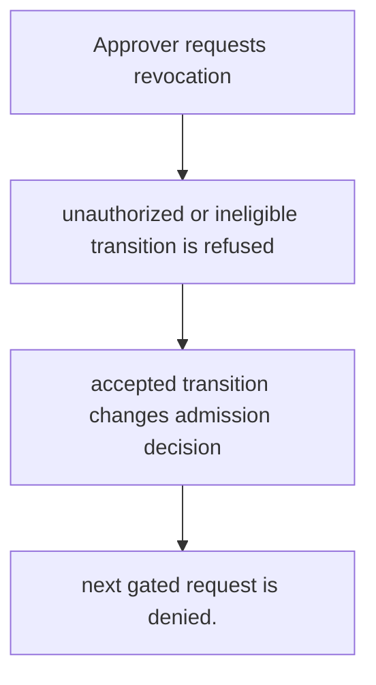
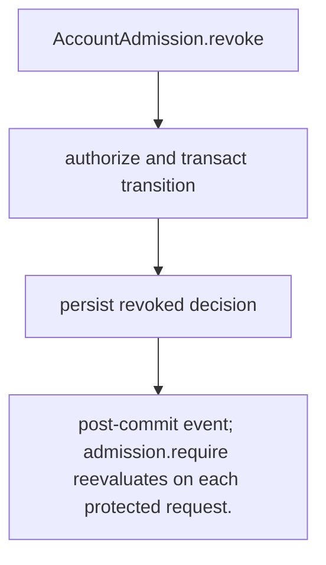

# US-ACCOUNT-27 — Revoke a prior admission decision

As an authorized application approver, I want to revoke an admitted account’s decision so that I can remove admission eligibility while preserving the account credential.

**Status:** Current when approval is enabled
**Access:** Host approval authorization callback; revocation does not itself sign the user out.
**Entry:** Host-owned controller calls `AccountAdmission.revoke`; no built-in admission routes.
**Documentation:** [admission.md](../docs/guide/admission.md)
**Source:** [`src/admission/decisions.ts`](../src/admission/decisions.ts)
**Coverage:** [`tests/admission_decisions.spec.ts`](../tests/admission_decisions.spec.ts)

## Acceptance criteria

- **Inputs and result:** actorId, target user and transition context; returns updated admission state. The host owns any screen, request parsing and presentation unless the entry explicitly names a managed route or command.
- next gated request is denied.
- Refusal, expiry, stale state or post-commit delivery behavior follows the linked service contract; a committed mutation is not described as rolled back because a follow-up failed.

## User flow

## Code flow

Scope: this is the Account Kit service/command path. Host UI, route policy and external systems remain host-owned unless named.

**Code references:** [implementation](../src/admission/decisions.ts), [`tests/admission_decisions.spec.ts`](../tests/admission_decisions.spec.ts)
