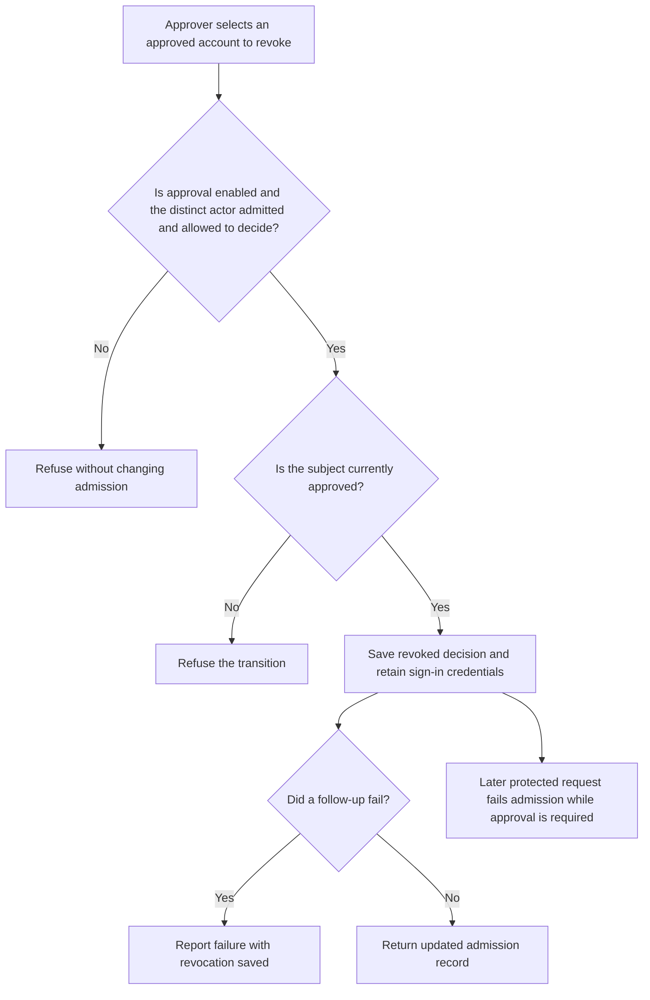
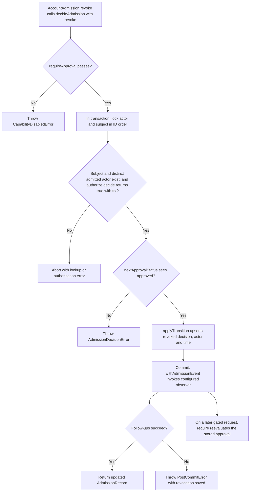

# US-ACCOUNT-27 — Revoke a prior admission decision

As an authorised application approver, I want to revoke an admitted account’s decision so that I can remove admission eligibility while preserving the account credential.

**Status:** Current when approval is enabled
**Access:** Host approval authorisation callback; revocation does not itself sign the user out.
**Entry:** Host-owned controller calls `AccountAdmission.revoke`; no built-in admission routes.
**Documentation:** [admission.md](../docs/guide/admission.md)
**Source:** [`src/admission/decisions.ts`](../src/admission/decisions.ts)
**Coverage:** [`tests/admission_decisions.spec.ts`](../tests/admission_decisions.spec.ts)

## Acceptance criteria

- `revoke({ actorId, userId })` requires enabled approval and the same distinct, admitted actor and `authorize.decide(actor, subject, { trx })` check as [US-ACCOUNT-26](US-ACCOUNT-26-decide-admission.md). The subject must exist and be `approved`; a refused transition preserves the existing decision.
- Success returns the record with revoked status, actor and decision time. The configured observer receives `admission.revoked` after commit. Its failure reports `PostCommitError` with revocation saved. Existing credentials remain valid subject to their own checks, and future admission gates refuse the account while approval is required and revoked.

## User flow

## Code flow

Scope: this is the Account Kit service/command path. Host UI, route policy and external systems remain host-owned unless named.

**Code references:** [implementation](../src/admission/decisions.ts), [`tests/admission_decisions.spec.ts`](../tests/admission_decisions.spec.ts), [service and gate](../src/admission/service.ts), [committed events](../src/admission/events.ts)
