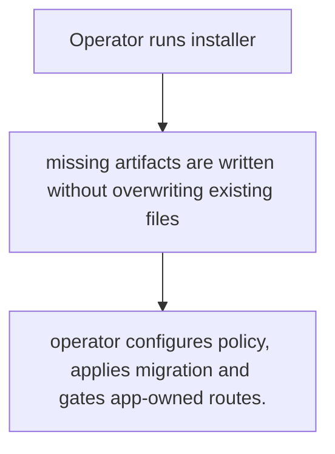
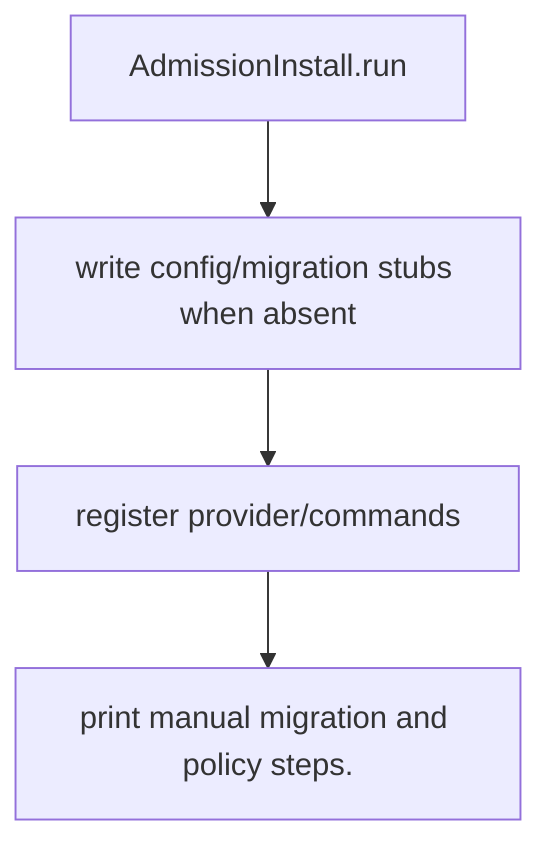

# US-ACCOUNT-28 — Install the optional admission module

As an application operator, I want to add admission migration, configuration, provider and commands so that I can make admission available for explicit host configuration.

**Status:** Operator
**Access:** Operator must configure at least one requirement, host approval authority and route middleware; installer does not create app roles/routes.
**Entry:** Run `account-kit:admission:install [--users-table] [--user-id-type]`; then review migration/config and run migrations.
**Documentation:** [admission.md](../docs/guide/admission.md)
**Source:** [`commands/admission_install.ts`](../commands/admission_install.ts)
**Coverage:** [`tests/admission_install_command.spec.ts`](../tests/admission_install_command.spec.ts)

## Acceptance criteria

- **Inputs and result:** optional users table and user id type; command reports created/skipped artifacts. The host owns any screen, request parsing and presentation unless the entry explicitly names a managed route or command.
- operator configures policy, applies migration and gates app-owned routes.
- Refusal, expiry, stale state or post-commit delivery behavior follows the linked service contract; a committed mutation is not described as rolled back because a follow-up failed.

## User flow

## Code flow

Scope: this is the Account Kit service/command path. Host UI, route policy and external systems remain host-owned unless named.

**Code references:** [implementation](../commands/admission_install.ts), [`tests/admission_install_command.spec.ts`](../tests/admission_install_command.spec.ts)
