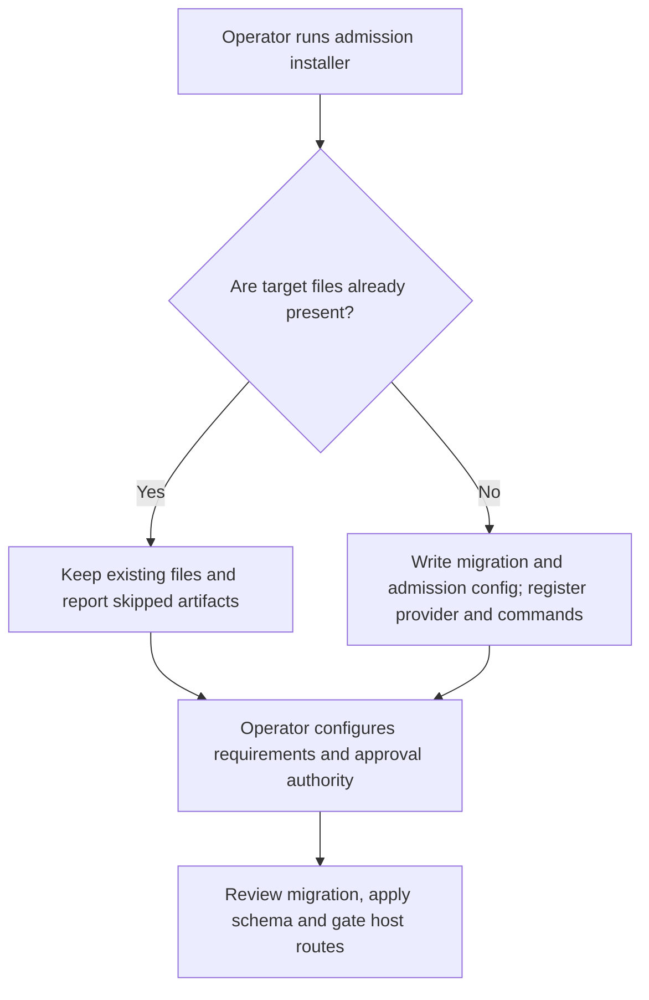
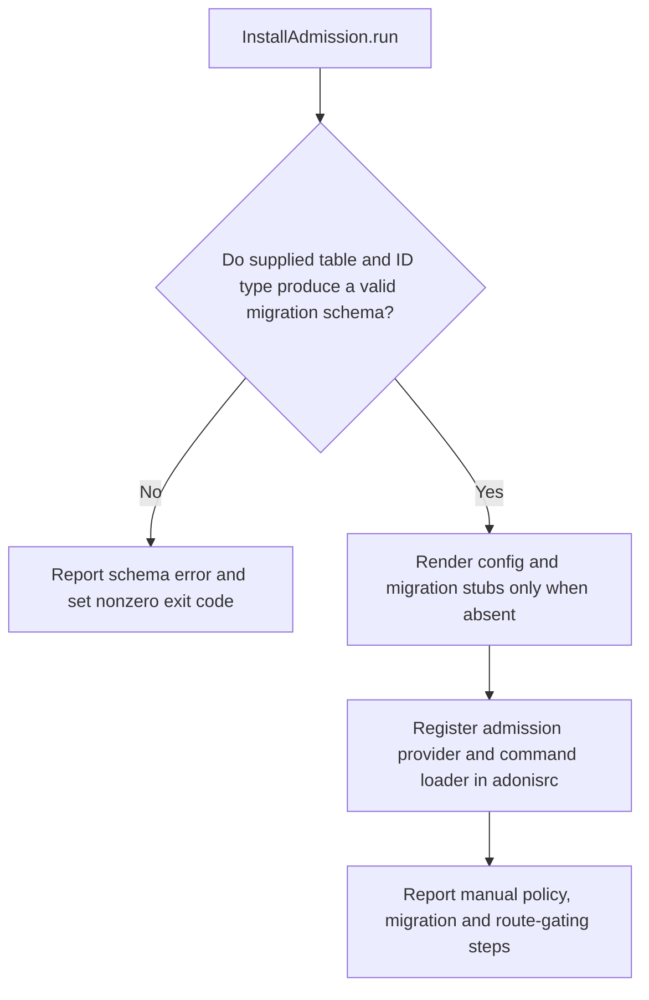

# US-ACCOUNT-28 — Install the optional admission module

As an application operator, I want to add admission migration, configuration, provider and commands so that I can make admission available for explicit host configuration.

**Status:** Operator
**Access:** Operator must configure at least one requirement, host approval authority and route middleware; installer does not create app roles/routes.
**Entry:** Run `account-kit:admission:install [--users-table=<table>] [--user-id-type=<integer|string|uuid>]`; defaults are `users` and `integer`. Then review migration/config and run migrations.
**Documentation:** [admission.md](../docs/guide/admission.md)
**Source:** [`commands/admission_install.ts`](../commands/admission_install.ts)
**Coverage:** [`tests/admission_install_command.spec.ts`](../tests/admission_install_command.spec.ts)

## Acceptance criteria

- **Inputs and result:** `InstallAdmission.run()` handles `account-kit:admission:install [--users-table=<table>] [--user-id-type=<integer|string|uuid>]`; defaults are `users` and `integer`. Invalid schema inputs report an error and set the command exit code. It writes missing config/migration and registers the provider/command loader, while preserving existing config and migration files. It does not define application roles, authorization callbacks or protected routes; the operator must review config and run migrations.

## User flow

## Code flow

Scope: this is the Account Kit service/command path. Host UI, route policy and external systems remain host-owned unless named.

**Code references:** [implementation](../commands/admission_install.ts), [`tests/admission_install_command.spec.ts`](../tests/admission_install_command.spec.ts)
