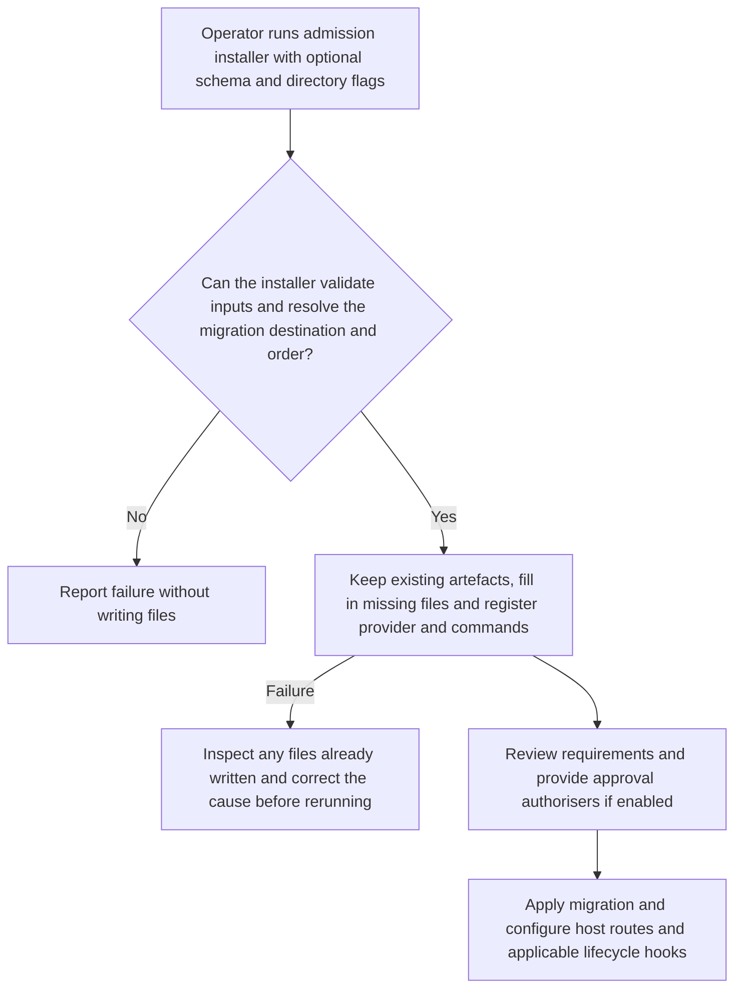
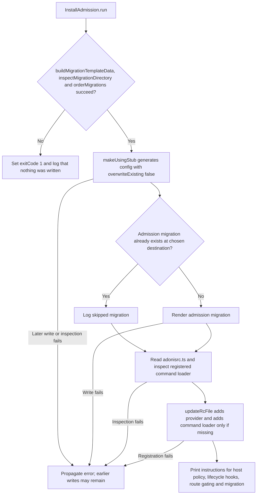

# US-ACCOUNT-28 — Install the optional admission module

As an application operator, I want to add admission migration, configuration, provider and commands so that I can make admission available for explicit host configuration.

**Status:** Operator
**Access:** Operator runs the installer in an existing Account Kit app. Host chooses at least one requirement, approval authority when enabled, and the guarded routes.
**Entry:** Run `account-kit:admission:install [--users-table=<table>] [--user-id-type=<integer|string|uuid>] [--migration-directory=<path>] [--env=NAME=value ...]`; defaults are `users` and `integer`. Then review migration/config and run migrations.
**Documentation:** [admission.md](../docs/guide/admission.md)
**Source:** [`commands/admission_install.ts`](../commands/admission_install.ts)
**Coverage:** [`tests/admission_install_command.spec.ts`](../tests/admission_install_command.spec.ts)

## Acceptance criteria

- Repeat `--env=NAME=value` to supply explicit environment overrides for migration inspection. Each name must be valid and unique; invalid assignments fail before writing. The installer does not use ambient shell values for this inspection. Use `--env=NODE_ENV=production` to select production-mode dotenv files, as in [Account Kit setup](US-ACCOUNT-31-configure-account-kit.md#acceptance-criteria).
- The users table defaults to `users` and ID type to `integer`. The installer accepts `integer`, `string` or `uuid`. An application-relative `--migration-directory` confirms a dynamic path or selects one of several configured paths. If the selected path lacks the admission migration, the command refuses to generate a duplicate already in another configured path. It also refuses a non-default destination when core Account Kit migrations remain in the default directory.
- It validates the schema and resolves the primary Lucid migration destination and filename order before writing. Invalid destination or ordering (including untimestamped filenames and mixed timestamp widths) exits with code 1 and reports that nothing was written.
- It preserves existing artefacts, writes missing config and migration, and registers the provider and command loader. Generated config enables approval with both authorisers returning `false`. An operator chooses requirements and supplies approval authority when approval is enabled, either [inline or through the registry](../docs/guide/admission.md#configuration), applies the migration and sets up host routes and applicable lifecycle wrappers.
- Failures after validation can occur after a file has been written; inspect the application and rerun after correcting the cause.

## User flow

## Code flow

Scope: this is the Account Kit service/command path. Host UI, route policy and external systems remain host-owned unless named.

**Code references:** [implementation](../commands/admission_install.ts), [`tests/admission_install_command.spec.ts`](../tests/admission_install_command.spec.ts), [migration directories](../src/setup/migration_paths.ts), [migration order](../src/setup/migration_order.ts), [generated config](../stubs/config/admission.stub)
