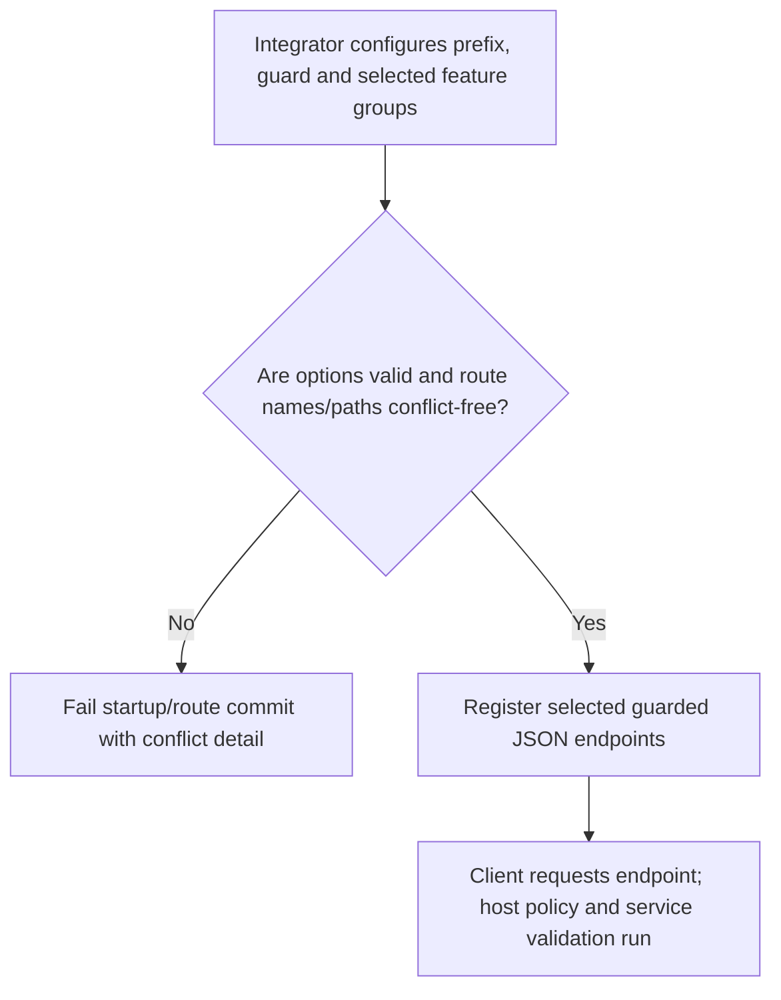
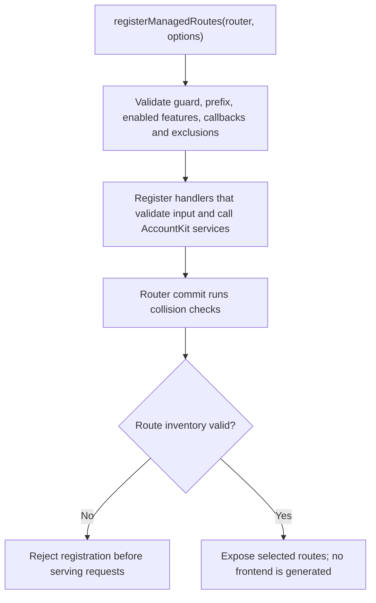

# US-ACCOUNT-29 — Mount selected managed JSON routes

As an application integrator, I want to register the chosen service-backed endpoints so that I can reuse validated HTTP handlers while retaining host policy.

**Status:** Current when the application explicitly calls route registration
**Access:** Host chooses prefix, guard, enabled feature set, route exclusions and surrounding middleware; no frontend is supplied.
**Entry:** Call `registerManagedRoutes(router, options)` from application routes.
**Documentation:** [managed-http.md](../docs/guide/managed-http.md)
**Source:** [`src/http/managed.ts`](../src/http/managed.ts)
**Coverage:** [`tests/managed_http_route_registration.spec.ts`](../tests/managed_http_route_registration.spec.ts), [`tests/managed_http_live_account.spec.ts`](../tests/managed_http_live_account.spec.ts)

## Acceptance criteria

- **Inputs and result:** `registerManagedRoutes(router, options)` registers only the explicitly enabled route groups under the chosen prefix and guard; exclusions and callbacks are host configuration. Route conflicts are checked when the router commits. The package supplies JSON handlers, not a frontend.

## User flow

## Code flow

Scope: this is the Account Kit service/command path. Host UI, route policy and external systems remain host-owned unless named.

**Code references:** [implementation](../src/http/managed.ts), [`tests/managed_http_route_registration.spec.ts`](../tests/managed_http_route_registration.spec.ts), [`tests/managed_http_live_account.spec.ts`](../tests/managed_http_live_account.spec.ts)
