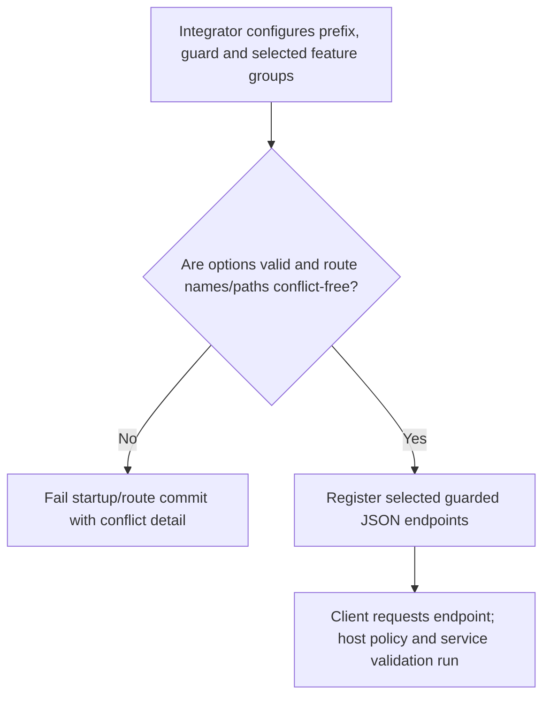
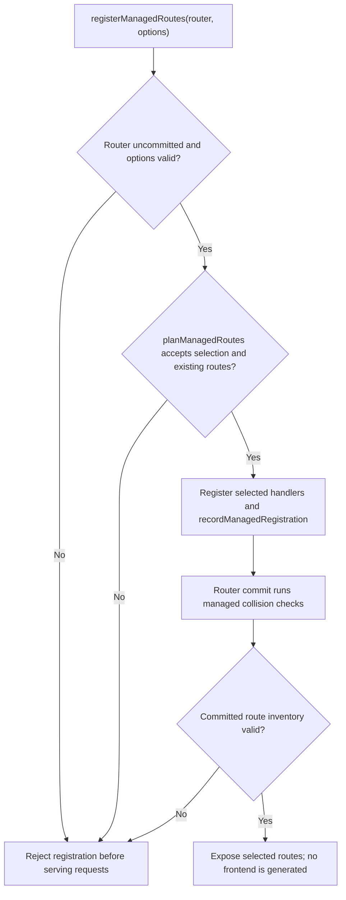

# US-ACCOUNT-29 — Mount selected managed JSON routes

As an application integrator, I want to register the chosen service-backed endpoints so that I can reuse validated HTTP handlers while retaining host policy.

**Status:** Current when the application explicitly calls route registration
**Access:** Host chooses prefix, guard, enabled feature set, route exclusions and surrounding middleware; no frontend is supplied.
**Entry:** Call `registerManagedRoutes(router, options)` from application routes.
**Documentation:** [managed-http.md](../docs/guide/managed-http.md)
**Source:** [`src/http/managed.ts`](../src/http/managed.ts)
**Coverage:** [`tests/managed_http_route_registration.spec.ts`](../tests/managed_http_route_registration.spec.ts), [`tests/managed_http_live_account.spec.ts`](../tests/managed_http_live_account.spec.ts)

## Acceptance criteria

- **Inputs and result:** `registerManagedRoutes(router, { prefix, guard, kit, enabled, ... })` registers the enabled route groups under the chosen prefix and guard, plus the [session CSRF endpoint when applicable](US-ACCOUNT-61-obtain-session-csrf-token.md); `kit()` is required, while `verificationRequired` defaults to `true` when omitted. Exclusions and callbacks are host configuration. Route conflicts are checked when the router commits. The package supplies JSON handlers, not a frontend.

- Selected handlers use the shared [managed request and response contract](REFERENCE.md#managed-request-and-response-boundary).

## User flow

## Code flow

Scope: this is the Account Kit service/command path. Host UI, route policy and external systems remain host-owned unless named.

**Code references:** [registerManagedRoutes](../src/http/managed.ts), [route planning](../src/http/routes.ts), [option validation](../src/http/managed_options.ts), [`tests/managed_http_route_registration.spec.ts`](../tests/managed_http_route_registration.spec.ts), [`tests/managed_http_live_account.spec.ts`](../tests/managed_http_live_account.spec.ts)
