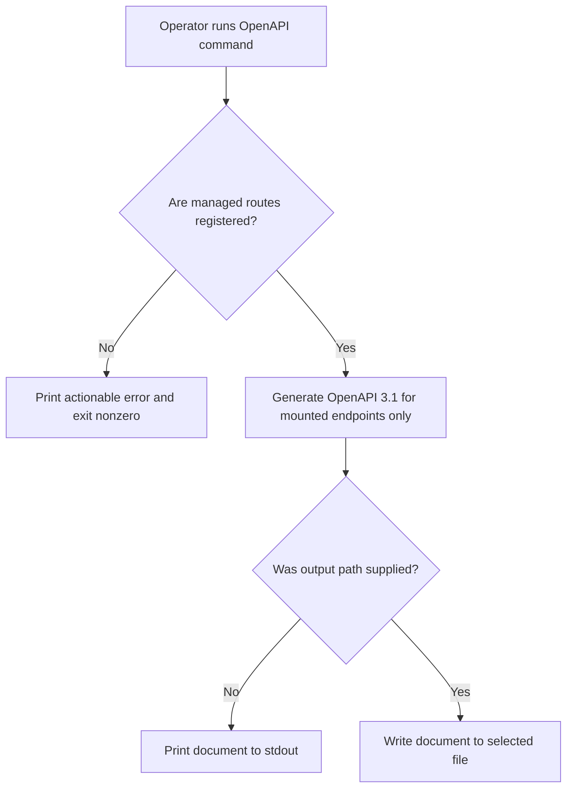
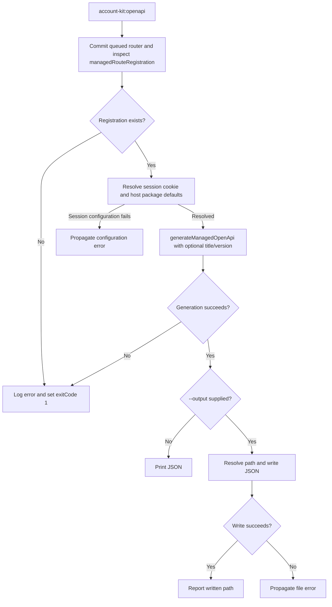

# US-ACCOUNT-30 — Generate an OpenAPI document for mounted routes

As an application operator, I want to write a contract for the managed endpoints actually registered so that I can provide clients and reviewers with the active route surface.

**Status:** Operator
**Access:** Managed routes must already be registered in the application route inventory.
**Entry:** Run `account-kit:openapi [--output <path>] [--title <title>] [--api-version <version>]`.
**Documentation:** [OpenAPI reference](../docs/reference/openapi.md)
**Source:** [`commands/openapi.ts`](../commands/openapi.ts)
**Coverage:** [`tests/openapi_command.spec.ts`](../tests/openapi_command.spec.ts)

## Acceptance criteria

- **Inputs and result:** `account-kit:openapi` accepts optional `--output`, `--title` and `--api-version`; title and version default to the host package name and version, with `Account API` and `0.0.0` as fallbacks. Without output it prints JSON to stdout. An output path is resolved from the application root. It commits/inspects the host router and refuses when no managed route registration exists.

## User flow

## Code flow

Scope: this is the Account Kit service/command path. Host UI, route policy and external systems remain host-owned unless named.

**Code references:** [implementation](../commands/openapi.ts), [`tests/openapi_command.spec.ts`](../tests/openapi_command.spec.ts)
