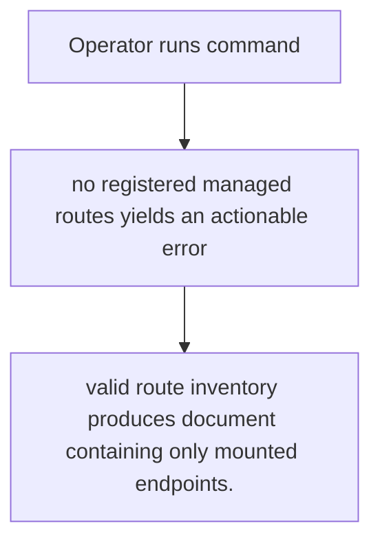
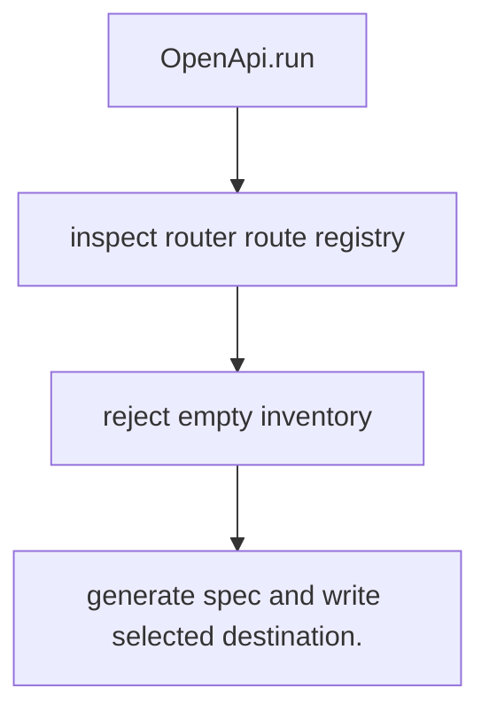

# US-ACCOUNT-30 — Generate an OpenAPI document for mounted routes

As an application operator, I want to write a contract for the managed endpoints actually registered so that I can provide clients and reviewers with the active route surface.

**Status:** Operator
**Access:** Managed routes must already be registered in the application route inventory.
**Entry:** Run `account-kit:openapi [--output]`; command writes OpenAPI 3.1 for the discovered route set.
**Documentation:** [../reference/openapi.md](../docs/guide/../reference/openapi.md)
**Source:** [`commands/openapi.ts`](../commands/openapi.ts)
**Coverage:** [`tests/openapi.spec.ts`](../tests/openapi_command.spec.ts)

## Acceptance criteria

- **Inputs and result:** optional output path; routes are read from application router; result is a generated document. The host owns any screen, request parsing and presentation unless the entry explicitly names a managed route or command.
- valid route inventory produces document containing only mounted endpoints.
- Refusal, expiry, stale state or post-commit delivery behavior follows the linked service contract; a committed mutation is not described as rolled back because a follow-up failed.

## User flow

## Code flow

Scope: this is the Account Kit service/command path. Host UI, route policy and external systems remain host-owned unless named.

**Code references:** [implementation](../commands/openapi.ts), [`tests/openapi.spec.ts`](../tests/openapi_command.spec.ts)
