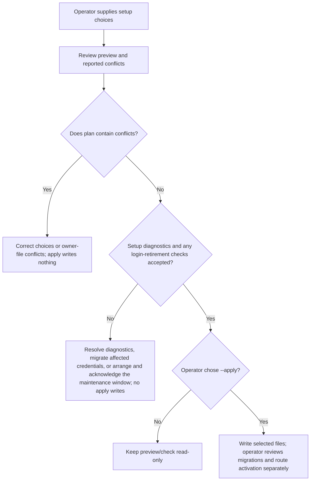
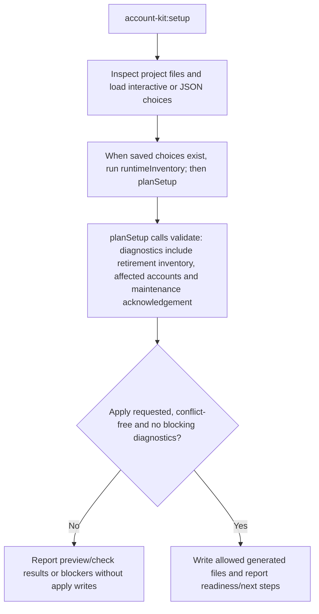

# US-ACCOUNT-31 — Preview and apply Account Kit setup

As an application operator, I want to configure package integration from reviewed setup choices so that I can generate a consistent starting point without overwriting owner files.

**Status:** Operator
**Access:** Existing conflicts block apply. If login-method retirement is proposed, its impact inventory must be available, no affected account may remain, and the operator must acknowledge the configured maintenance window with `--retirement-maintenance-window`. The host still owns guard, policies, route activation and migration execution.
**Entry:** Run `account-kit:setup` interactively or `--input`; preview by default, then `--apply` or `--check`.
**Documentation:** [setup.md](../docs/guide/setup.md)
**Source:** [`commands/setup.ts`](../commands/setup.ts)
**Coverage:** [`tests/setup_command.spec.ts`](../tests/setup_command.spec.ts)

## Acceptance criteria

- **Inputs and result:** `account-kit:setup` accepts the interactive prompts or the same JSON keys with `--input`; defaults, exact prompt labels, options and conditional questions are listed in the [setup choices reference](../docs/reference/setup-choices.md#interactive-interview). No flag previews by default, `--apply` writes a conflict-free plan, `--check` inspects saved choices, and `--production` adds deployment checks. It writes selected integration files only; migration execution, guard policy and active route cutover remain operator-controlled.
- Removing an existing password or social login method is blocked when the impact inventory is unavailable or any account would lose its last usable method. With zero affected accounts, apply still requires `--retirement-maintenance-window` to acknowledge a host-operated maintenance window. The flag does not lock credentials or prevent concurrent changes; the operator must enforce the window.

## User flow

## Code flow

Scope: this is the Account Kit service/command path. Host UI, route policy and external systems remain host-owned unless named.

**Code references:** [implementation](../commands/setup.ts), [planSetup](../src/setup/plan.ts), [validate and retirementDiagnostics](../src/setup/validate.ts), [`tests/setup_command.spec.ts`](../tests/setup_command.spec.ts)
