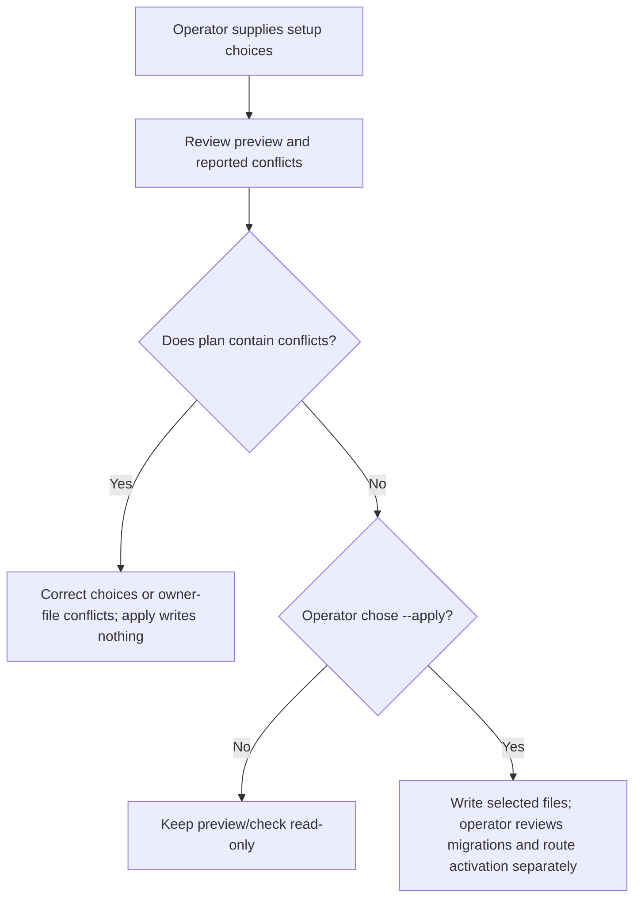
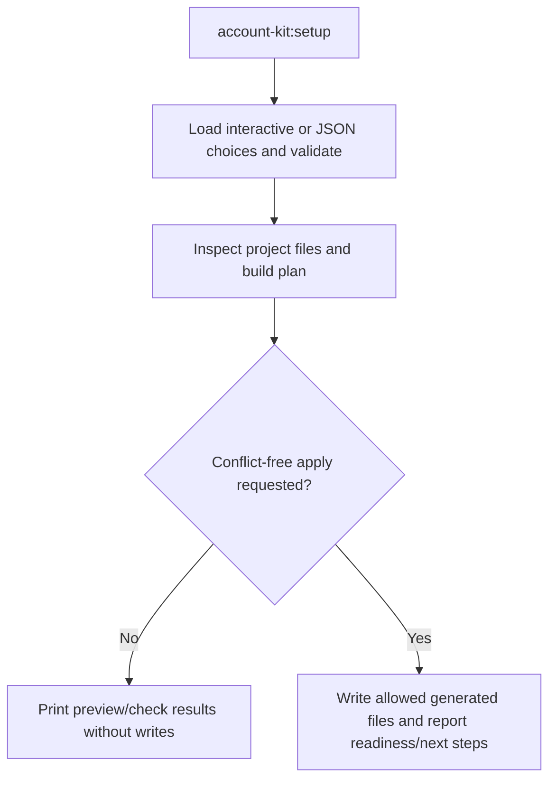

# US-ACCOUNT-31 — Preview and apply Account Kit setup

As an application operator, I want to configure package integration from reviewed setup choices so that I can generate a consistent starting point without overwriting owner files.

**Status:** Operator
**Access:** Existing conflicts block apply; host still owns guard, policies, route activation and migration execution.
**Entry:** Run `account-kit:setup` interactively or `--input`; preview by default, then `--apply` or `--check`.
**Documentation:** [setup.md](../docs/guide/setup.md)
**Source:** [`commands/setup.ts`](../commands/setup.ts)
**Coverage:** [`tests/setup_command.spec.ts`](../tests/setup_command.spec.ts)

## Acceptance criteria

- **Inputs and result:** `account-kit:setup` accepts interactive choices or `--input`; no flag previews by default, `--apply` writes a conflict-free plan, `--check` inspects saved choices, and `--production` adds deployment checks. It writes selected integration files only; migration execution, guard policy and active route cutover remain operator-controlled.

## User flow

## Code flow

Scope: this is the Account Kit service/command path. Host UI, route policy and external systems remain host-owned unless named.

**Code references:** [implementation](../commands/setup.ts), [`tests/setup_command.spec.ts`](../tests/setup_command.spec.ts)
