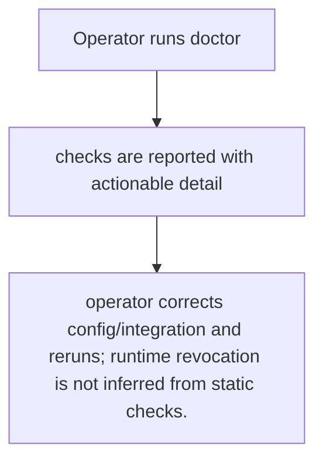
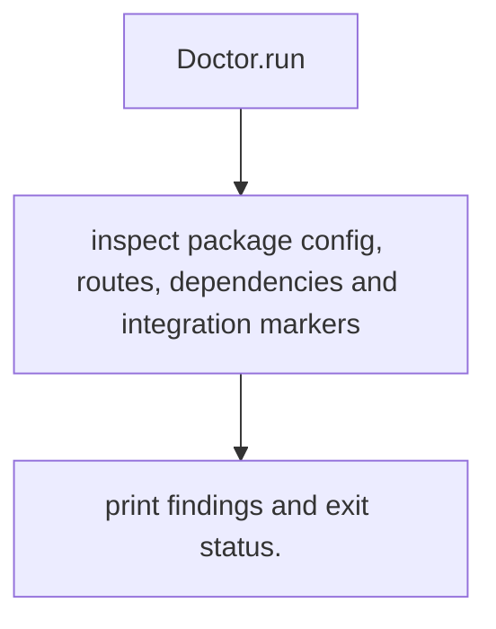

# US-ACCOUNT-32 — Diagnose Account Kit configuration

As an application operator, I want to check configuration and integration readiness so that I can find missing or inconsistent setup before serving account journeys.

**Status:** Operator
**Access:** Requires configured application; diagnostic output does not prove live workflow behavior.
**Entry:** Run `account-kit:doctor` in the host application.
**Documentation:** [operations.md](../docs/guide/operations.md)
**Source:** [`commands/doctor.ts`](../commands/doctor.ts)
**Coverage:** [`tests/doctor.spec.ts`](../tests/doctor.spec.ts)

## Acceptance criteria

- **Inputs and result:** application configuration and filesystem inventory; returns diagnostic report/status. The host owns any screen, request parsing and presentation unless the entry explicitly names a managed route or command.
- operator corrects config/integration and reruns; runtime revocation is not inferred from static checks.
- Refusal, expiry, stale state or post-commit delivery behavior follows the linked service contract; a committed mutation is not described as rolled back because a follow-up failed.

## User flow

## Code flow

Scope: this is the Account Kit service/command path. Host UI, route policy and external systems remain host-owned unless named.

**Code references:** [implementation](../commands/doctor.ts), [`tests/doctor_command.spec.ts`](../tests/doctor.spec.ts)
