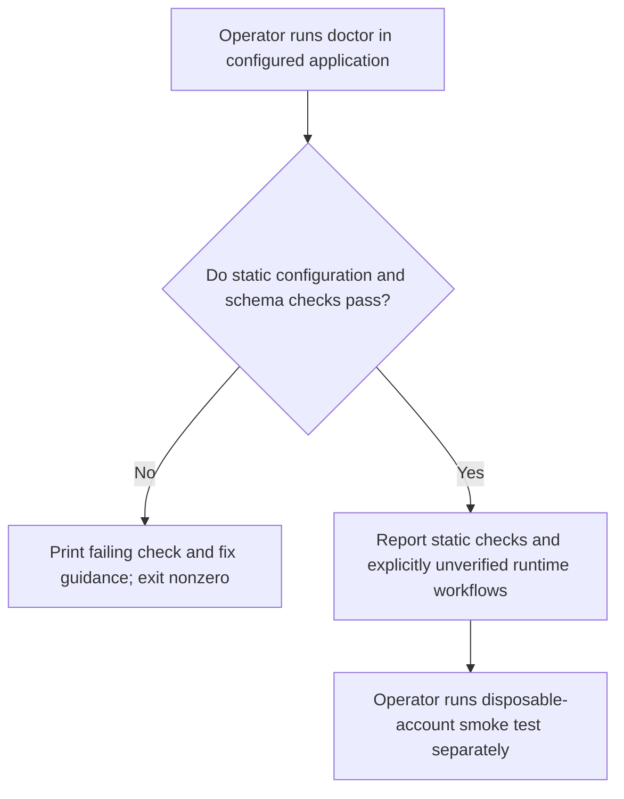
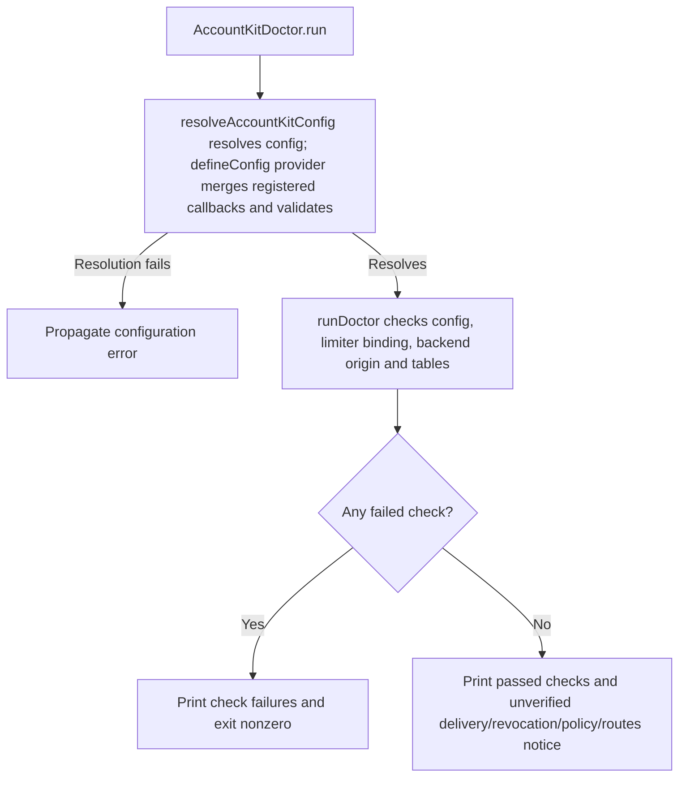

# US-ACCOUNT-32 — Diagnose Account Kit configuration

As an application operator, I want to check configuration and integration readiness so that I can find missing or inconsistent setup before serving account journeys.

**Status:** Operator
**Access:** Requires configured application; diagnostic output does not prove live workflow behaviour.
**Entry:** Run `account-kit:doctor [--app-url <origin>]` in the host application.
**Documentation:** [operations.md](../docs/guide/operations.md)
**Source:** [`commands/doctor.ts`](../commands/doctor.ts)
**Coverage:** [`tests/doctor.spec.ts`](../tests/doctor.spec.ts)

## Acceptance criteria

- **Inputs and result:** `account-kit:doctor` starts the app and reports configuration, limiter, backend-origin and database-table checks with a failing exit status when checks fail. The optional `--app-url` supplies the backend origin when it is absent from configured action URLs. The command does not itself read `APP_URL`; pass its value explicitly when needed. It resolves the same config and [registered callbacks](US-ACCOUNT-65-register-provider-callbacks.md) as the service. A resolution error stops the command before the checks. After passing checks, the final notice identifies unexercised delivery, credential revocation, application policy and routes.

## User flow

## Code flow

Scope: this is the Account Kit service/command path. Host UI, route policy and external systems remain host-owned unless named.

**Code references:** [implementation](../commands/doctor.ts), [config resolution](../src/config_resolution.ts), [defineConfig provider](../src/config.ts), [checks](../src/doctor.ts), [`tests/doctor.spec.ts`](../tests/doctor.spec.ts)
