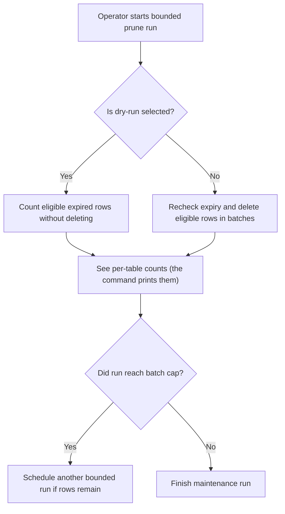
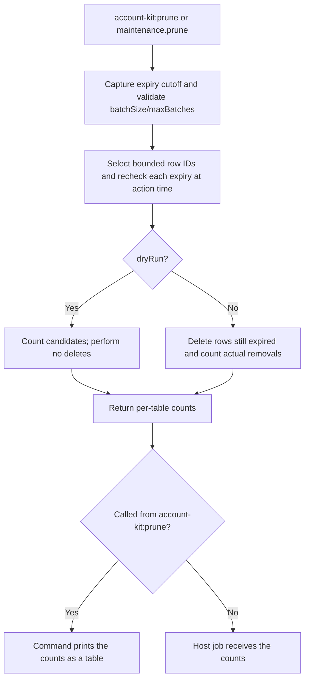

# US-ACCOUNT-33 — Prune expired proof and session records

As an application operator, I want to remove eligible expired rows in bounded batches so that I can control storage growth without deleting accounts or host records.

**Status:** Operator
**Access:** Explicit scheduled invocation; dry-run is available; batch limits come from the run flags or `prune` input (both default to 100, range 1–1000), not from configuration.
**Entry:** Run `account-kit:prune [--dry-run] [--batch-size] [--max-batches]`, or call the public `AccountKit.maintenance.prune({ batchSize?, maxBatches?, dryRun? })` from a scheduled host job; the command and the service both call `pruneExpired`.
**Documentation:** [operations.md](../docs/guide/operations.md)
**Source:** [`commands/prune.ts`](../commands/prune.ts), [`src/maintenance.ts`](../src/maintenance.ts)
**Coverage:** [`tests/maintenance.spec.ts`](../tests/maintenance.spec.ts)

## Acceptance criteria

- **Inputs and result:** `account-kit:prune` accepts `--dry-run`, `--batch-size` and `--max-batches`, and `maintenance.prune` takes the matching `dryRun`, `batchSize` and `maxBatches` options (all optional); an out-of-range value throws `RangeError`. Batch values are 1–1000, with defaults of 100. Reported counts cover this run only; `max-batches` is shared across all tables and dry-run batches use the same budget. It reports eligible rows in dry-run or rows actually deleted across expired proof/session tables; it does not delete users or application records.

## User flow

## Code flow

Scope: this is the Account Kit service/command path. Host UI, route policy and external systems remain host-owned unless named.

**Code references:** [implementation](../commands/prune.ts), [`pruneExpired`](../src/maintenance.ts), [`maintenance` service](../src/account_kit.ts), [`tests/maintenance.spec.ts`](../tests/maintenance.spec.ts)
