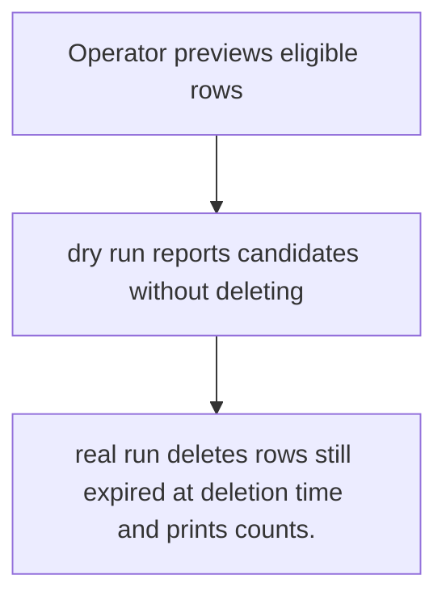
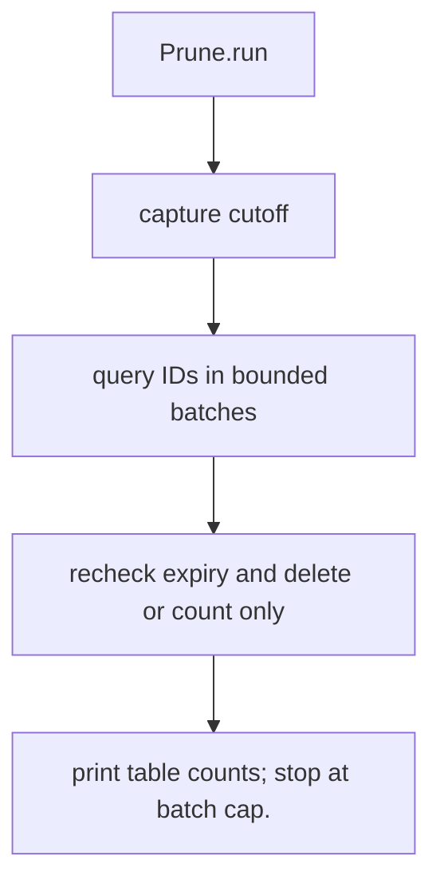

# US-ACCOUNT-33 — Prune expired proof and session records

As an application operator, I want to remove eligible expired rows in bounded batches so that I can control storage growth without deleting accounts or host records.

**Status:** Operator
**Access:** Explicit scheduled invocation; dry-run is available; configured batch limits apply.
**Entry:** Run `account-kit:prune [--dry-run] [--batch-size] [--max-batches]`.
**Documentation:** [operations.md](../docs/guide/operations.md)
**Source:** [`commands/prune.ts`](../commands/prune.ts)
**Coverage:** [`tests/prune_command.spec.ts`](../tests/maintenance.spec.ts)

## Acceptance criteria

- **Inputs and result:** dry-run flag and bounded batch settings; command returns per-table counts. The host owns any screen, request parsing and presentation unless the entry explicitly names a managed route or command.
- real run deletes rows still expired at deletion time and prints counts.
- Refusal, expiry, stale state or post-commit delivery behavior follows the linked service contract; a committed mutation is not described as rolled back because a follow-up failed.

## User flow

## Code flow

Scope: this is the Account Kit service/command path. Host UI, route policy and external systems remain host-owned unless named.

**Code references:** [implementation](../commands/prune.ts), [`tests/prune_command.spec.ts`](../tests/maintenance.spec.ts)
