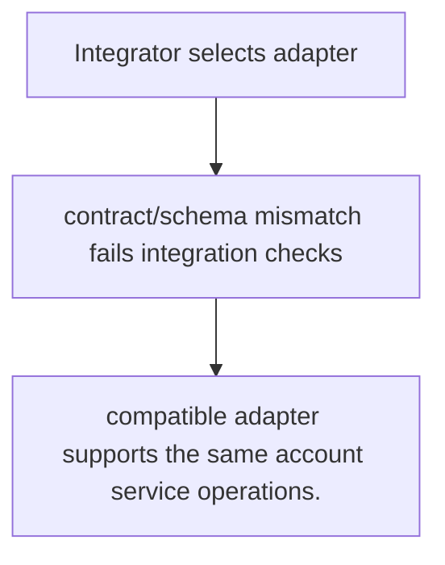
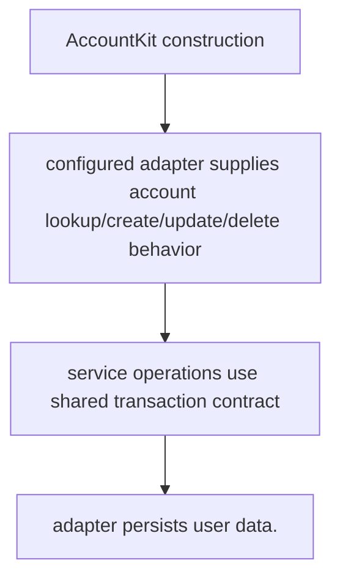

# US-ACCOUNT-34 — Integrate an application user model

As an application integrator, I want to connect Account Kit to a supported user persistence layer so that I can use account services without requiring a Lucid user model.

**Status:** Current
**Access:** Integrator supplies user adapter; transaction, schema and ID compatibility must match selected database/driver.
**Entry:** Configure the user adapter in Account Kit; supported adapters include Lucid, Drizzle, Prisma and SQL.
**Documentation:** [adapters.md](../docs/guide/adapters.md)
**Source:** [`adapters/index.ts`](../adapters/lucid.ts)
**Coverage:** [`tests/drizzle_adapter.spec.ts`](../tests/drizzle_adapter.spec.ts), [`tests/prisma_adapter.spec.ts`](../tests/prisma_adapter.spec.ts), [`tests/sql_adapter.spec.ts`](../tests/sql_adapter.spec.ts)

## Acceptance criteria

- **Inputs and result:** adapter implementing exported user adapter contract and configured transaction/database connection. The host owns any screen, request parsing and presentation unless the entry explicitly names a managed route or command.
- compatible adapter supports the same account service operations.
- Refusal, expiry, stale state or post-commit delivery behavior follows the linked service contract; a committed mutation is not described as rolled back because a follow-up failed.

## User flow

## Code flow

Scope: this is the Account Kit service/command path. Host UI, route policy and external systems remain host-owned unless named.

**Code references:** [implementation](../adapters/lucid.ts), [`tests/drizzle_adapter.spec.ts`](../tests/drizzle_adapter.spec.ts), [`tests/prisma_adapter.spec.ts`](../tests/prisma_adapter.spec.ts), [`tests/sql_adapter.spec.ts`](../tests/sql_adapter.spec.ts)
