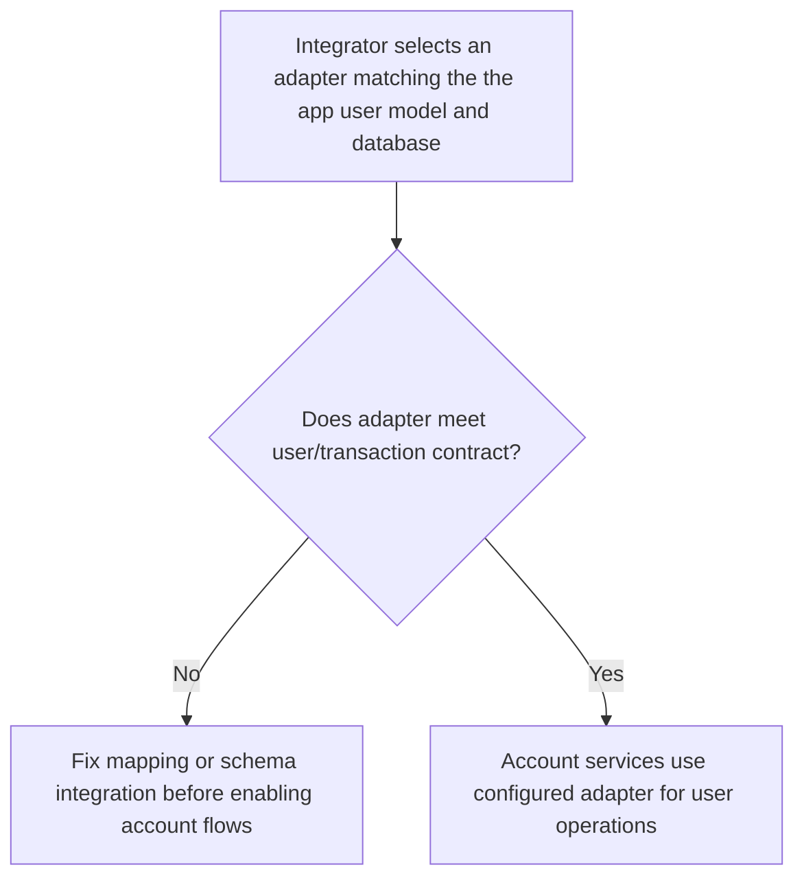
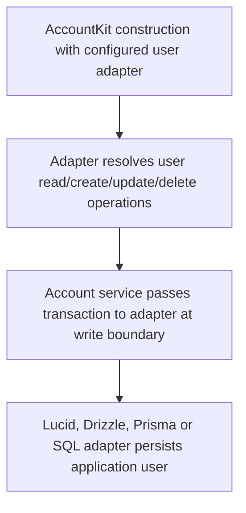

# US-ACCOUNT-34 — Integrate an application user model

As an application integrator, I want to connect Account Kit to a supported user persistence layer so that I can use account services without requiring a Lucid user model.

**Status:** Current
**Access:** Integrator supplies user adapter; transaction, schema and ID compatibility must match selected database/driver.
**Entry:** Configure the user adapter in Account Kit; supported adapters include Lucid, Drizzle, Prisma and SQL.
**Documentation:** [adapters.md](../docs/guide/adapters.md)
**Source:** [`adapters/index.ts`](../adapters/lucid.ts)
**Coverage:** [`tests/drizzle_adapter.spec.ts`](../tests/drizzle_adapter.spec.ts), [`tests/prisma_adapter.spec.ts`](../tests/prisma_adapter.spec.ts), [`tests/sql_adapter.spec.ts`](../tests/sql_adapter.spec.ts)

## Acceptance criteria

- **Inputs and result:** The adapter contract lets `AccountKit` read, create, update and delete the application user inside supplied database transactions. Lucid is the default adapter; Drizzle, Prisma and SQL factories are included. Integrators configure the adapter and use the same service API; schema/driver compatibility follows the adapter guide and contract suite.

## User flow

## Code flow

Scope: this is the Account Kit service/command path. Host UI, route policy and external systems remain host-owned unless named.

**Code references:** [implementation](../adapters/lucid.ts), [`tests/drizzle_adapter.spec.ts`](../tests/drizzle_adapter.spec.ts), [`tests/prisma_adapter.spec.ts`](../tests/prisma_adapter.spec.ts), [`tests/sql_adapter.spec.ts`](../tests/sql_adapter.spec.ts)
