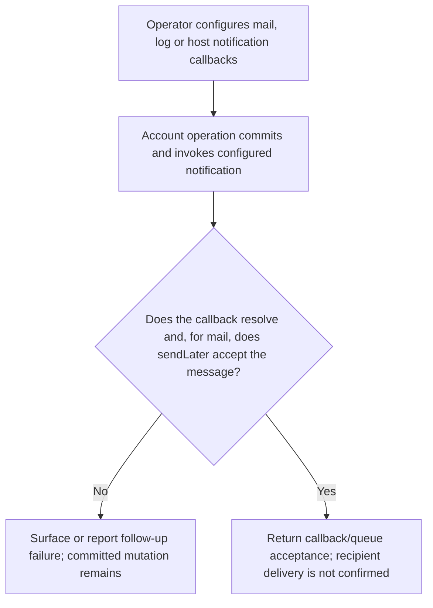
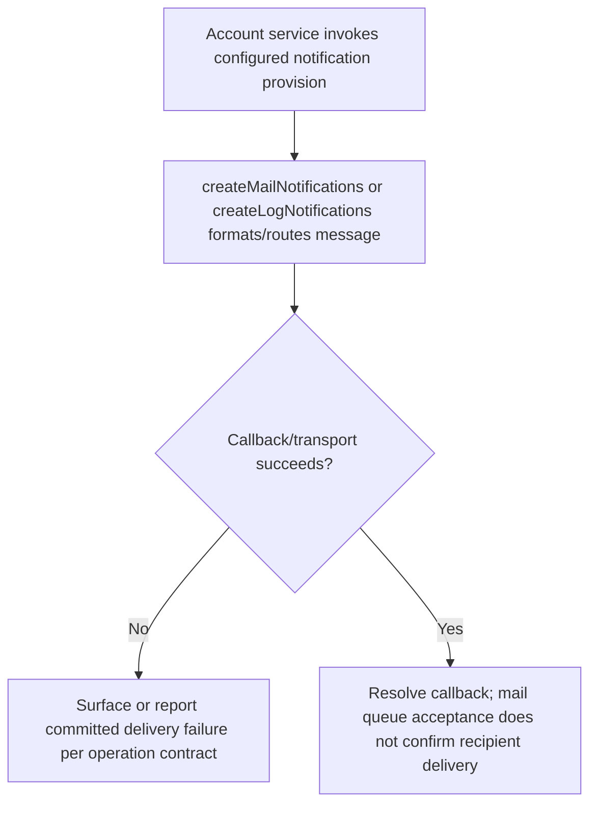

# US-ACCOUNT-35 — Deliver account notifications

As an application operator, I want to connect account events to mail or host-owned notification delivery so that I can deliver verification, recovery and lifecycle messages using app policy.

**Status:** Current
**Access:** Host configures mail/provision callbacks, translations and delivery transport; provider acceptance is not recipient delivery.
**Entry:** Configure notification callbacks or use maintained mail/log helpers; service operations invoke provisions at documented transaction boundaries.
**Documentation:** [notifications.md](../docs/guide/notifications.md)
**Source:** [`src/notifications.ts`](../src/notifications.ts)
**Coverage:** [`tests/notifications.spec.ts`](../tests/notifications.spec.ts)

## Acceptance criteria

- **Inputs and result:** Configure `notify` provision callbacks for the enabled events, or use `createMailNotifications`/`createLogNotifications`; message rendering and translation helpers are public. The package invokes notification callbacks after the operation commits. A transport/observer failure after commit does not roll back the account mutation. Separate transaction hooks are not notification callbacks.
- **Helper inputs:** `createMailNotifications` requires `from` and `brandName`; `createLogNotifications` requires `brandName` and `environment` (`development` or `test`) and refuses `production` because logged links are live bearer credentials.

## User flow

## Code flow

Scope: this is the Account Kit service/command path. Host UI, route policy and external systems remain host-owned unless named.

**Code references:** [implementation](../src/notifications.ts), [`tests/notifications.spec.ts`](../tests/notifications.spec.ts)
