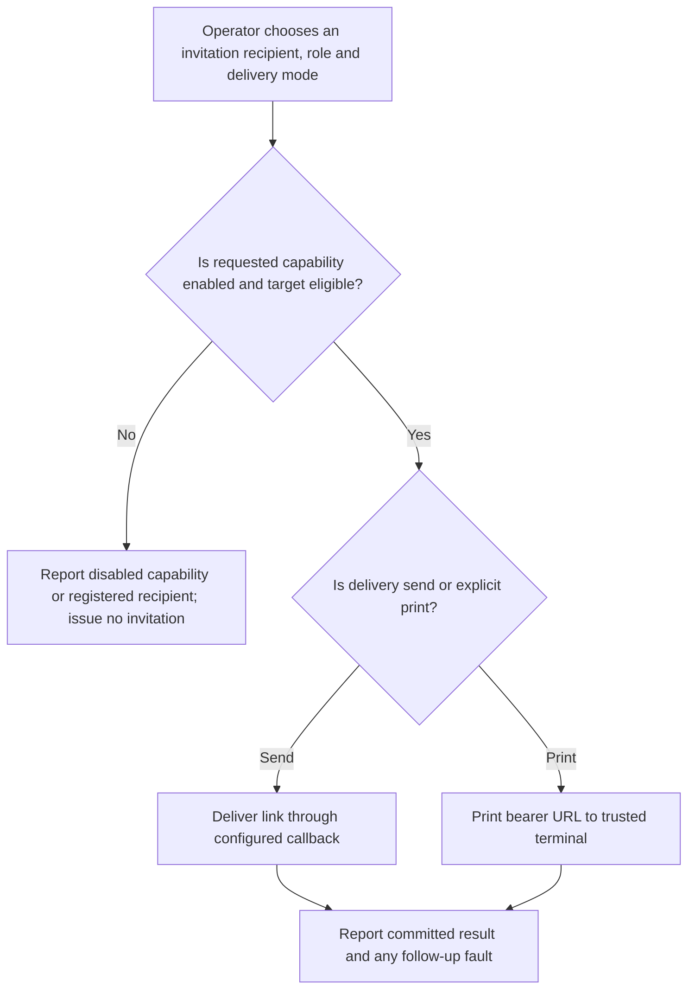
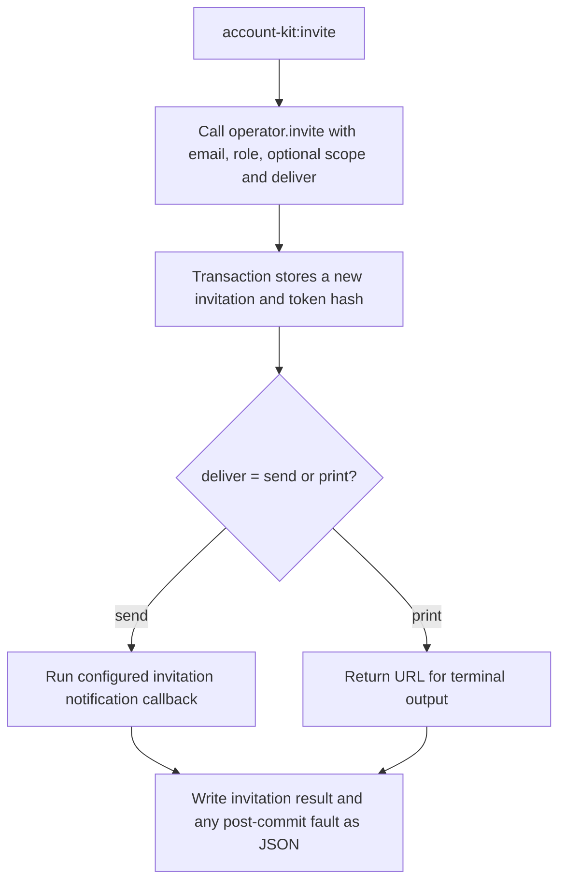

# US-ACCOUNT-36 — Issue an invitation from the shell

As an application operator, I want to bootstrap an application invitation through trusted operator commands so that I can bootstrap an invitation without exposing a privileged HTTP capability.

**Status:** Operator
**Access:** Requires shell access and configured invitations capability; operator commands bypass actor authorization and throttles.
**Entry:** Run `account-kit:invite <email> --role <role> [--scope <scope>] [--print]`.
**Documentation:** [operations.md](../docs/guide/operations.md)
**Source:** [`commands/invite.ts`](../commands/invite.ts)
**Coverage:** [`tests/operator_commands.spec.ts`](../tests/operator_commands.spec.ts)

## Acceptance criteria

- **Inputs and result:** `operator.invite({ email, role, scope?, deliver })` returns an invitation, optional printed URL and optional follow-up fault. `deliver` is `send` or `print`. Shell access is the authority boundary: this operation has no actor callback or public throttle; a printed URL is a bearer secret.

## User flow

## Code flow

Scope: this is the Account Kit service/command path. Host UI, route policy and external systems remain host-owned unless named.

**Code references:** [implementation](../commands/invite.ts), [`tests/operator_commands.spec.ts`](../tests/operator_commands.spec.ts)
