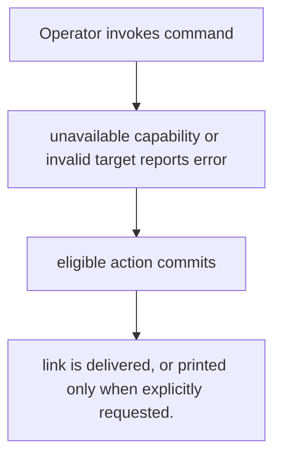
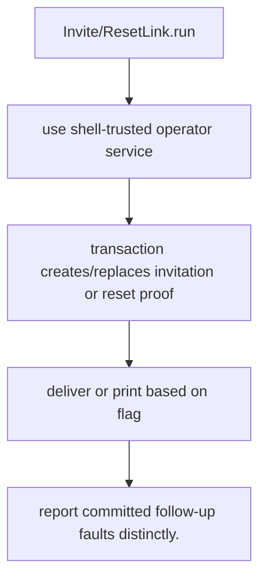

# US-ACCOUNT-36 — Issue an invitation or reset link from the shell

As an application operator, I want to help a user or bootstrap an account through trusted operator commands so that I can complete recovery without exposing a privileged HTTP capability.

**Status:** Operator
**Access:** Requires shell access and configured invitation/password-reset capability; operator commands bypass actor authorization and throttles.
**Entry:** Run `account-kit:invite <email> [--role] [--scope] [--print]` or `account-kit:reset-link <email> [--print]`.
**Documentation:** [operations.md](../docs/guide/operations.md)
**Source:** [`commands/invite.ts`](../commands/invite.ts)
**Coverage:** [`tests/operator_commands.spec.ts`](../tests/operator_commands.spec.ts)

## Acceptance criteria

- **Inputs and result:** recipient email plus command-specific options; `--print` prints bearer link instead of delivery. The host owns any screen, request parsing and presentation unless the entry explicitly names a managed route or command.
- link is delivered, or printed only when explicitly requested.
- Refusal, expiry, stale state or post-commit delivery behavior follows the linked service contract; a committed mutation is not described as rolled back because a follow-up failed.

## User flow

## Code flow

Scope: this is the Account Kit service/command path. Host UI, route policy and external systems remain host-owned unless named.

**Code references:** [implementation](../commands/invite.ts), [`tests/operator_commands.spec.ts`](../tests/operator_commands.spec.ts)
