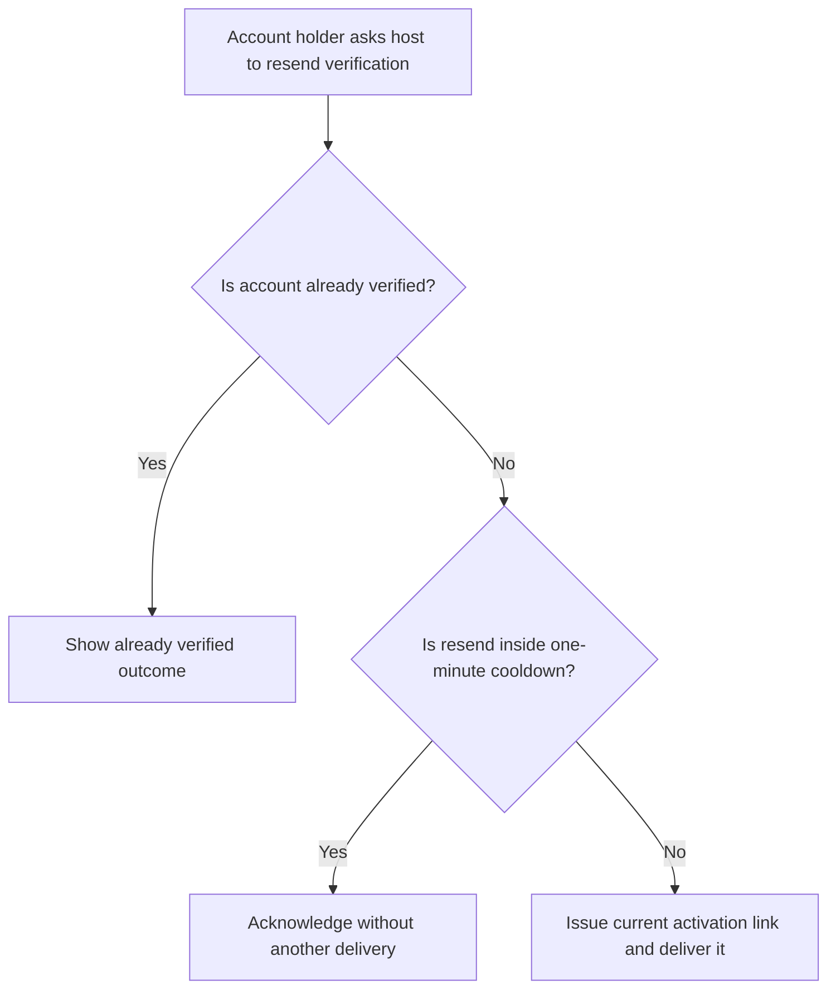
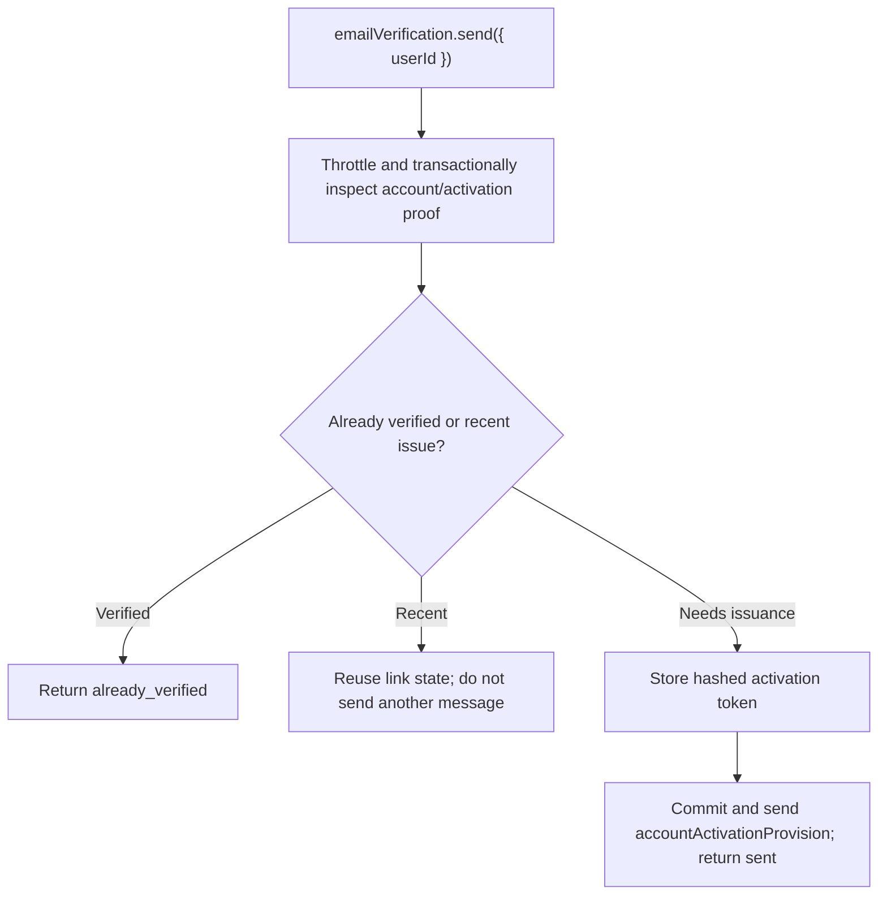

# US-ACCOUNT-37 — Resend email verification

As an account holder with an unconfirmed address, I want to request another verification link so that I can activate my account.

**Status:** Current when `emailVerification` is enabled
**Access:** The host supplies a userId from its authorized request context; Account Kit rate-limits per user.
**Entry:** Host calls `emailVerification.send({ userId })`; optional managed resend endpoint is explicitly enabled.
**Documentation:** [Registration](../docs/guide/registration.md)
**Source:** [`src/verification.ts`](../src/verification.ts)
**Coverage:** [`tests/verification.spec.ts`](../tests/verification.spec.ts)

## Acceptance criteria

- Required input is the account `userId`; result is `sent` or `already_verified`. A repeated request during the one-minute cooldown reuses the active link and does not send another message.
- An already-confirmed account returns `already_verified`; an eligible unconfirmed account receives an activation provision after issuance commits.

## User flow

## Code flow

Scope: service issuance and notification; the host owns the authenticated userId selection and response.

**Code references:** [`sendVerification`](../src/verification.ts), [`verification tests`](../tests/verification.spec.ts)
