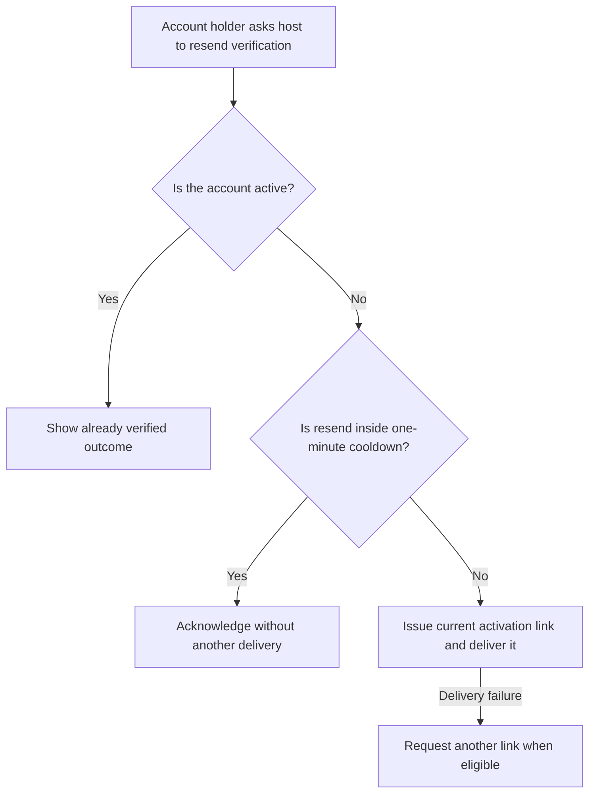
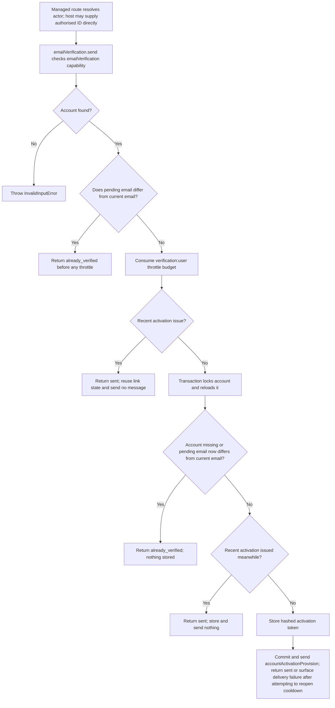

# US-ACCOUNT-37 — Resend email verification

As an account holder with an unconfirmed address, I want to request another verification link so that I can activate my account.

**Status:** Current when `emailVerification` is enabled
**Access:** The host supplies a userId from its authorised request context; Account Kit rate-limits per user.
**Entry:** Host calls `emailVerification.send({ userId })` or mounts `account.emailVerification.send` (POST `account/email-verification/send`, limited access).
**Documentation:** [Registration](../docs/guide/registration.md)
**Source:** [`src/verification.ts`](../src/verification.ts)
**Coverage:** [`tests/verification.spec.ts`](../tests/verification.spec.ts)

## Acceptance criteria

- Required input is the account `userId`; an unknown id throws `InvalidInputError`. The result is `sent` or `already_verified`. A repeated request during the one-minute cooldown reuses the active link and does not send another message.
- An active account returns `already_verified` without spending the per-user throttle budget. An account is active when its pending email differs from its current email, including when the pending email is null. The historical verification timestamp does not determine activation. A pending account outside the cooldown gets an activation provision after issuance commits.
- The managed handler derives `userId` from the authenticated account and returns 200 with `{ result }`. When delivery fails after issuance commits, the service attempts to reopen the cooldown so another request can deliver a fresh link.
- If the managed write recognises a committed follow-up failure, it returns 202 with `{ committed: true }`.

## User flow

## Code flow

**Code references:** [`sendVerification`](../src/verification.ts), [`verification tests`](../tests/verification.spec.ts), [managed verification send](../src/http/handlers_email_verification.ts), [resend cooldown](../src/token_reuse.ts), [managed committed-failure response](../src/http/managed.ts)
