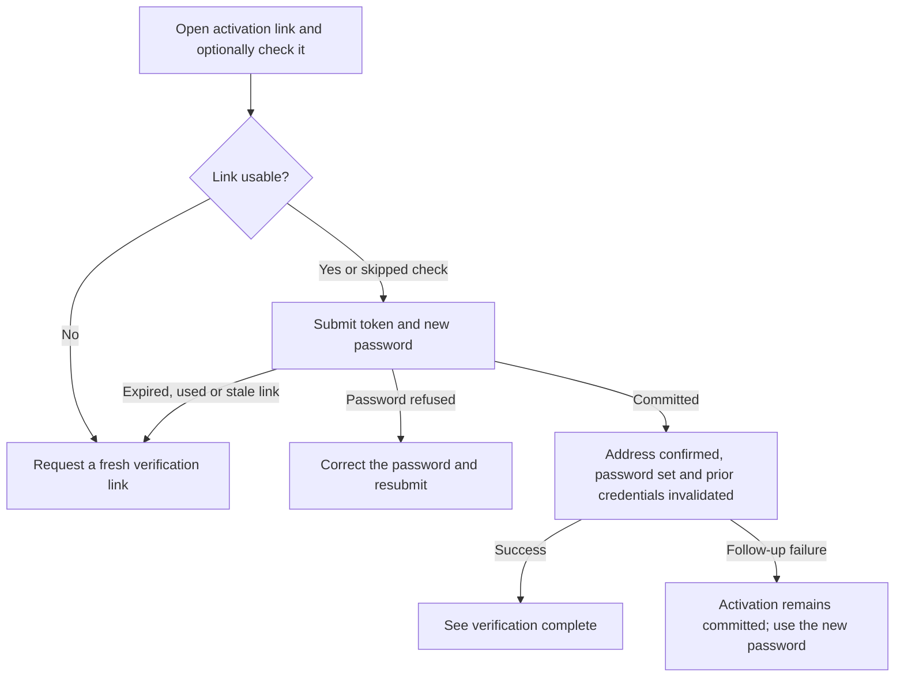
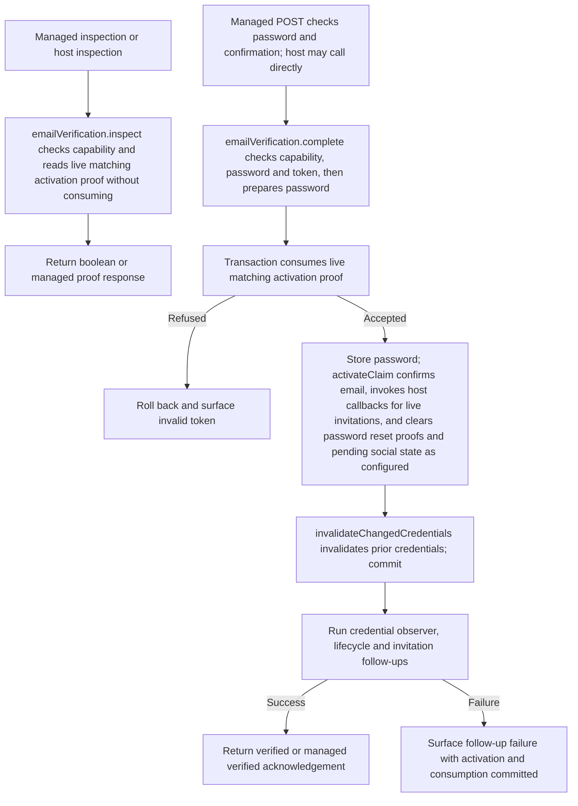

# US-ACCOUNT-38 — Confirm an email address

As an account holder with an activation link, I want to confirm my email address so that my account becomes active.

**Status:** Current when `emailVerification` is enabled
**Access:** A valid single-use activation token and a password accepted by configured policy are required.
**Entry:** Host calls `emailVerification.inspect` or `emailVerification.complete`. Managed GET/POST `auth/email-verification/:token` are public proof routes. The POST requires the [managed password fields](REFERENCE.md#managed-password-fields).
**Documentation:** [Registration](../docs/guide/registration.md)
**Source:** [`src/verification.ts`](../src/verification.ts)
**Coverage:** [`tests/verification.spec.ts`](../tests/verification.spec.ts)

## Acceptance criteria

- Inspection takes `token` and returns a boolean without spending it. Completion takes `token` and a new policy-valid password and returns `verified`.
- An invalid, expired or already-used token does not activate the account; a valid token is consumed once, confirms the address, sets the password, invalidates prior credentials, clears applicable recovery proofs and applies all live matching invitation grants when invitations are enabled.
- Credential observers and lifecycle callbacks run after commit. If a follow-up fails, activation and proof consumption remain committed; the user must not retry the consumed link as though activation rolled back.
- Managed inspection returns 200 with `{ valid: true }` or an invalid-proof response. Managed completion returns 200 with `{ verified: true }` on success.
- If the managed write recognises a committed follow-up failure, it returns 202 with `{ committed: true }`.

## User flow

## Code flow

**Code references:** [`inspectVerification` and `completeVerification`](../src/verification.ts), [`verification tests`](../tests/verification.spec.ts), [managed verification](../src/http/handlers_email_verification.ts), [activation transaction](../src/activation_claim.ts), [managed committed-failure response](../src/http/managed.ts)
