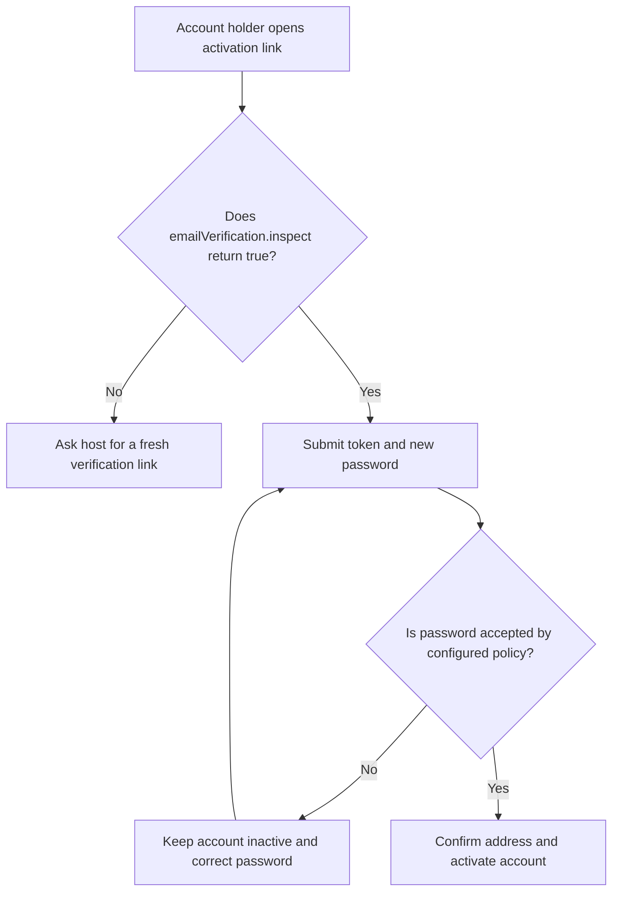
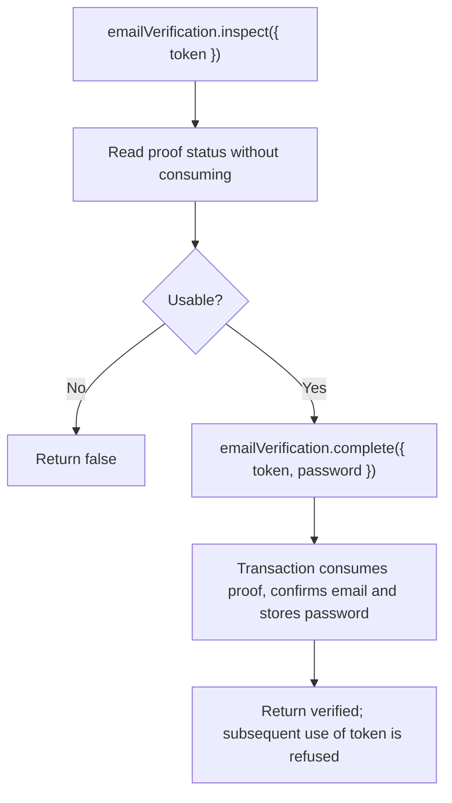

# US-ACCOUNT-38 — Confirm an email address

As an account holder with an activation link, I want to confirm my email address so that my account becomes active.

**Status:** Current when `emailVerification` is enabled
**Access:** A valid single-use activation token and a password accepted by configured policy are required.
**Entry:** Host calls `emailVerification.inspect({ token })` to check without consuming, then `emailVerification.complete({ token, password })`; optional managed routes are separate.
**Documentation:** [Registration](../docs/guide/registration.md)
**Source:** [`src/verification.ts`](../src/verification.ts)
**Coverage:** [`tests/verification.spec.ts`](../tests/verification.spec.ts)

## Acceptance criteria

- Inspection takes `token` and returns a boolean without spending it. Completion takes `token` and a new policy-valid password and returns `verified`.
- An invalid, expired or already-used token does not activate the account; a valid token is consumed once, confirms the address and sets the password.

## User flow

## Code flow

Scope: verification transaction and service result. Host owns the form, route and error presentation.

**Code references:** [`inspectVerification` and `completeVerification`](../src/verification.ts), [`verification tests`](../tests/verification.spec.ts)
