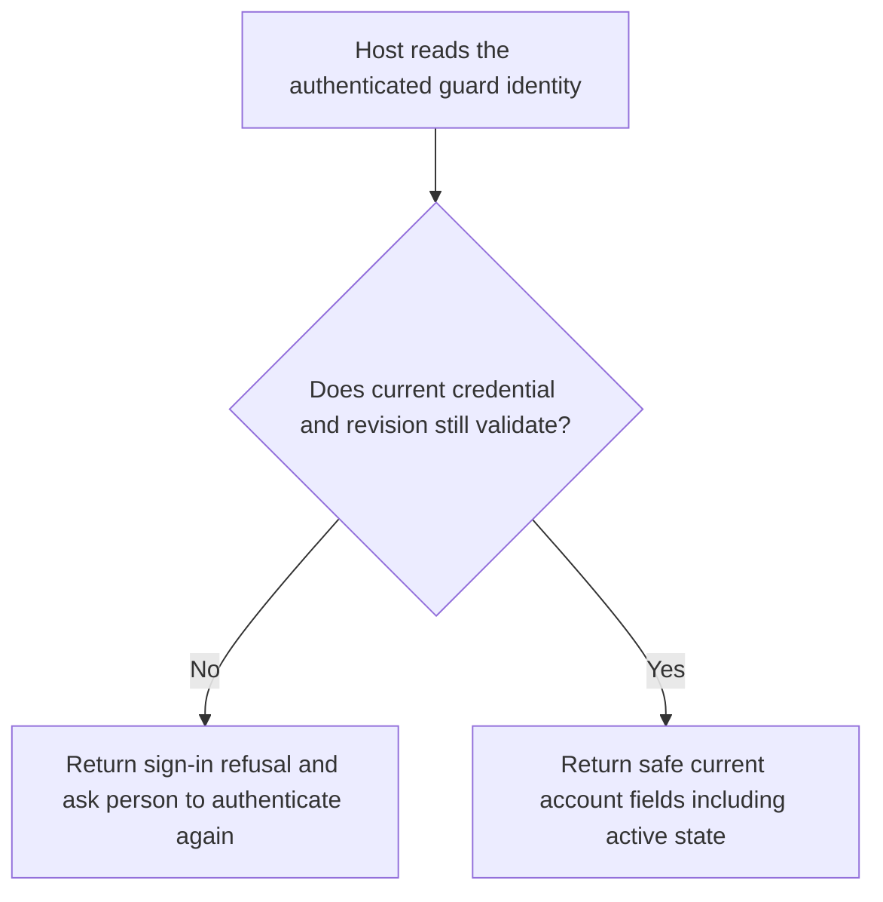
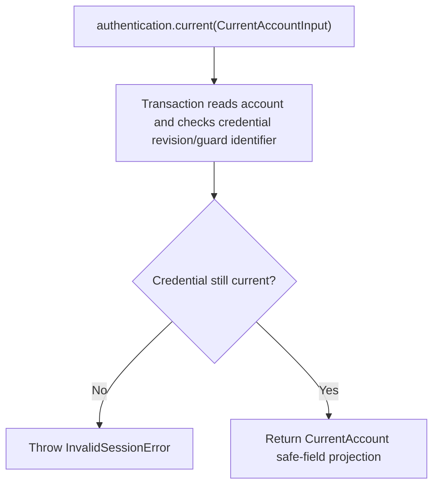

# US-ACCOUNT-39 — Read the current account

As a signed-in account holder, I want the application to check my current account so that it can show safe identity and activation state.

**Status:** Current when authentication is configured
**Access:** The host passes identifiers from its authenticated guard; Account Kit validates credential revision and sign-in state.
**Entry:** Host calls `authentication.current({ userId, revision?, tokenId?, sessionHandle? })`.
**Documentation:** [Authentication](../docs/guide/authentication.md)
**Source:** [`src/authentication.ts`](../src/authentication.ts)
**Coverage:** [`tests/authentication.spec.ts`](../tests/authentication.spec.ts)

## Acceptance criteria

- `CurrentAccountInput` includes `userId` and the strategy-specific credential data: revision, tokenId for access-token guards, and sessionHandle when session management is enabled. `current` returns only id, email, unverifiedEmail, hasPassword and active.
- A revoked credential, mismatched revision or missing/foreign sign-in handle is rejected; host must not treat the returned snapshot as a replacement credential.

## User flow

## Code flow

Scope: Account Kit credential validation and safe account projection; the host authenticates the incoming request.

**Code references:** [`current`](../src/authentication.ts), [`currentInTransaction`](../src/authentication.ts), [`authentication tests`](../tests/authentication.spec.ts)
