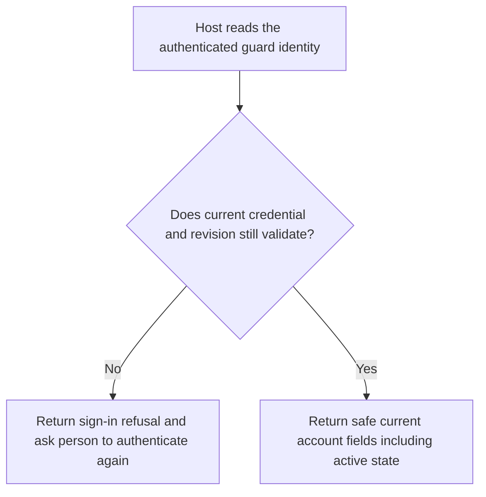
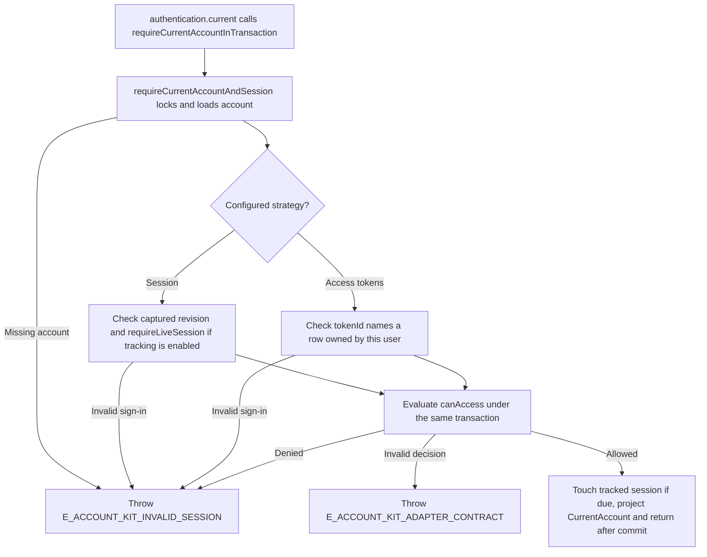

# US-ACCOUNT-39 — Read the current account

As a signed-in account holder, I want the application to check my current account so that it can show safe identity and activation state.

**Status:** Current when authentication is configured
**Access:** The host passes identifiers from its authenticated guard; Account Kit validates credential revision and sign-in state.
**Entry:** Host calls `authentication.current({ userId, revision?, tokenId?, sessionHandle? })`.
**Documentation:** [Authentication](../docs/guide/authentication.md)
**Source:** [`src/authentication.ts`](../src/authentication.ts)
**Coverage:** [`tests/authentication.spec.ts`](../tests/authentication.spec.ts)

## Acceptance criteria

- `CurrentAccountInput` includes `userId` and the strategy-specific credential data: an explicit `revision` (initially `null`) for session guards, plus `sessionHandle` when session management is enabled, or `tokenId` for access-token guards. `current` returns only id, email, unverifiedEmail, hasPassword and active.
- A missing account, stale revision, invalid sign-in row or denied `canAccess(user, trx)` produces `E_ACCOUNT_KIT_INVALID_SESSION`. An invalid decision value raises `E_ACCOUNT_KIT_ADAPTER_CONTRACT`. The selected host guard authenticates the incoming request and checks token expiry.

## User flow

## Code flow

Scope: the selected guard supplies trusted credential data. Account Kit checks current sign-in and policy in a transaction.

**Code references:** [`current`](../src/authentication.ts), [session checks](../src/session_tracking.ts), [decision validation](../src/account_access_decision.ts), [account projection](../src/account_projection.ts), [`authentication tests`](../tests/authentication.spec.ts)
